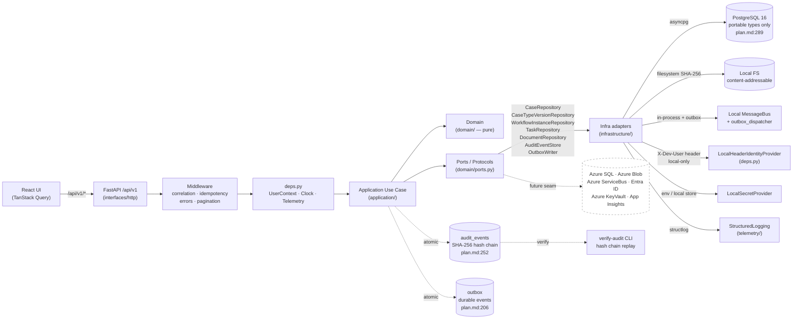
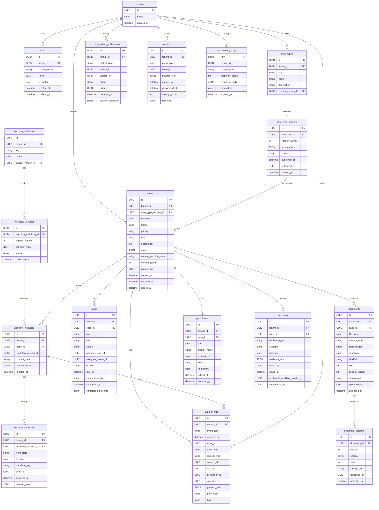
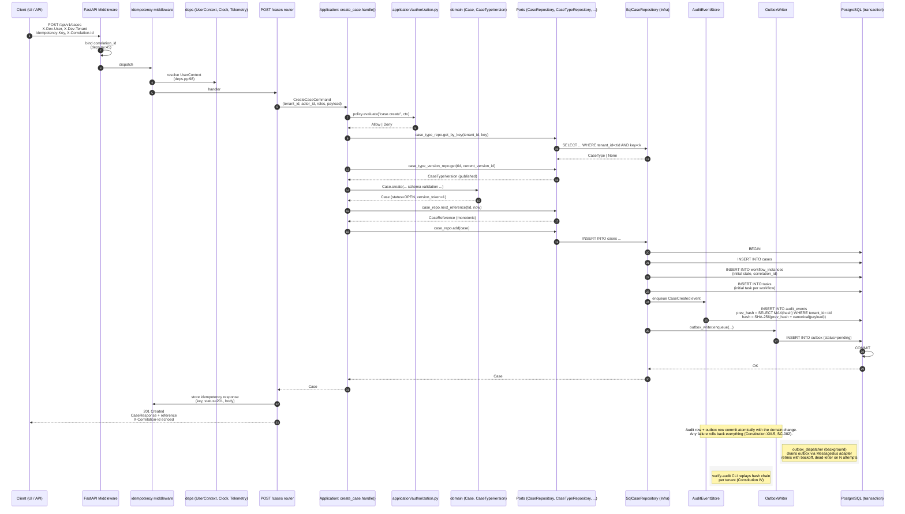
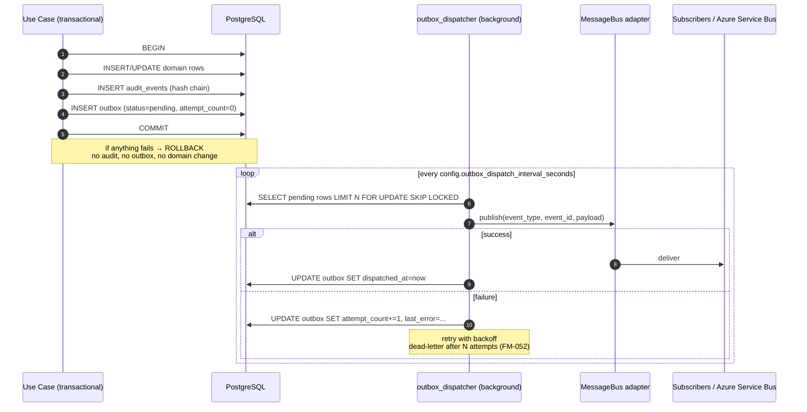

# Architecture: Case Management Platform — First Substantial Slice

**Feature Branch**: `001-case-management-platform`
**Spec**: [first-slice/spec.md](./first-slice/spec.md)
**Plan**: [first-slice/plan.md](./first-slice/plan.md)
**Constitution**: [../../.specify/memory/constitution.md](../../.specify/memory/constitution.md)
**Status**: Living document — updated as the slice converges (AGENTS.md §4.R9)
**Last updated**: 2026-09-03
**Decisions index**: [`docs/decisions/ADR-020-final.md`](../../docs/decisions/ADR-020-final.md)
**CI gate**: [`scripts/check_architecture_md.py`](../../scripts/check_architecture_md.py) — AGENTS.md §4.R9

This document records the architecture for the first substantial slice of the Case Management Platform. It is required by AGENTS.md §4.R9 and §13 before a slice can be marked done. Diagrams are Mermaid JS so they render directly in GitHub, the Orca viewer, and IDE previews.

---

## 1. System Overview

The platform is a **modular monolith** with explicit module boundaries enforced by `import-linter` (Constitution VII, XV; AGENTS.md §4.R10). The Case is the primary domain object (Constitution I). Core business behavior lives in the `domain` layer as pure, framework-free Python; the `application` layer orchestrates use cases against `Protocol` ports; the `infrastructure` layer implements those ports; the `interfaces/http` layer exposes a versioned REST API.

Configuration is data, not code: case-type schemas, workflow definitions, routing rules, and SLAs are validated JSON documents published as immutable versions (Constitution III, IX; AGENTS.md §16.2). The system runs **locally with synthetic data today** and is **shaped for Azure production tomorrow** (Constitution VI; AGENTS.md §3). Azure adapters are explicit seams (`docs/integrations/seams.md`, AGENTS.md §12), never inline `if local ... else azure ...` branches inside domain or application code (Constitution VI; AGENTS.md §3).

The first slice delivers a representative end-to-end vertical: **create case → route → work → document → decision → close → timeline** (Constitution XIII).

---

## 2. Mermaid Flowchart — End-to-End Request Path

The flowchart below is the canonical "happy path" for a user request. It traces from the React UI through the FastAPI HTTP layer into the application use case, into the domain (which is pure), through the Ports/Protocols, into the infrastructure adapters, and back. The audit hash chain and outbox are committed in the same DB transaction as the domain change. Azure seams are dotted lines — they are contracts today, adapters tomorrow.



### Reading the diagram

- **UI → API → App → Domain** is the deterministic request path. Domain is reached only through application use cases.
- **App → Ports → Infra** is the only path from business logic to external systems. The domain itself imports nothing from FastAPI, SQLAlchemy, or `infrastructure`.
- **App → Audit + Outbox** is shown as a dotted "atomic" edge. Both writes commit in the **same DB transaction** as the domain change (Constitution XIII.5; AGENTS.md §16.3; plan.md:206).
- **Ports → Azure** is dashed: today there are no Azure adapters. The dotted edge marks the seam — the place where Azure adapters plug in without changes to `domain/` or `application/`.

---

## 3. Module Map

The map below mirrors `backend/app/` and `frontend/src/` as laid out in plan.md:50. Each module declares its pillar (Constitution + plan.md §Pillar cross-cuts). Layer rules are enforced by `import-linter` (plan.md:50; AGENTS.md §4.R10).

```
backend/
  app/
    main.py                     # FastAPI app factory, middleware wiring
    config.py                   # Pydantic Settings, env-driven adapter selection
    db.py                       # SQLAlchemy async engine, session factory
    deps.py                     # FastAPI dependencies (auth, db, clock, telemetry)

    domain/                     # PURE — no FastAPI/SQLAlchemy imports
      tenant.py
      case_type.py              # CaseType + CaseTypeVersion   (P05, P10)
      case.py                   # Case, CaseStatus, CaseReference  (P01)
      workflow.py               # WorkflowDefinition + WorkflowVersion  (P02, P10)
      workflow_instance.py      # WorkflowInstance, Transition, Guard (P02)
      task.py                                            # (P02)
      document.py                                        # (P03)
      participant.py                                    # (P01)
      decision.py                                        # (P02)
      audit.py                  # AuditEvent              (P09)
      rules.py                  # Declarative JSON condition evaluator (P02, P05)
      events.py                 # Domain event base + outbox record (P13)
      ports.py                  # Infrastructure Protocols (P13, VI)
      errors.py                 # DomainError hierarchy

    application/                # Use cases, orchestration, transactions
      cases/
        create_case.py          # POST /cases
        view_case.py            # GET /cases/{id}
        edit_case.py            # PATCH /cases/{id}
      workflow/
        start_workflow.py       # P02
        execute_transition.py   # P02
        publish_workflow.py     # P10
      tasks/
        complete_task.py        # P02
      documents/
        upload_document.py      # P03
      decisions/
        record_decision.py      # P02
      audit/
        record_event.py         # P09
        view_timeline.py        # P09
      configuration/
        load_case_type.py       # P05
        load_workflow.py        # P10
        validate_definition.py  # P10
      authorization.py          # Policy registry, deny-by-default  (P11)

    infrastructure/             # Port implementations
      persistence/
        models.py               # SQLAlchemy ORM models (portable types only)
        repositories/           # SqlCaseRepository, etc. — tenant-scoped
        migrations/             # Alembic
      storage/
        local_document_store.py # filesystem, SHA-256
      messaging/
        local_message_bus.py
        outbox_dispatcher.py    # Background worker that drains the outbox
      identity/
        local_identity_provider.py   # X-Dev-User / X-Dev-Tenant
        current_user.py              # Auth dependency (deps.py)
      secrets/
        local_secret_provider.py
      clock/
        system_clock.py
      telemetry/
        structured_logging.py
        correlation.py          # Correlation/causation IDs per request

    interfaces/
      http/
        routers/                # /cases, /tasks, /workflows, /documents, /audit, /admin, /health
        schemas/                # Pydantic request/response models
        errors.py               # Structured ErrorResponse (Constitution V)
        idempotency.py          # Idempotency-Key middleware
        pagination.py           # Page[T] default 50 / max 200
      cli/                      # Typer CLI: synthetic seed, dry-run import, verify-audit
      events/
        local_event_handlers.py # In-process subscribers

frontend/
  src/
    api/                        # Typed API client (openapi-typescript from /openapi.json)
    cases/                      # Case workspace
    tasks/                      # Task list + task detail
    documents/                  # Document upload + viewer
    audit/                      # Timeline view
    workflow/                   # Transition actions
    shell/                      # Layout, nav, error boundary, SYNTHETIC banner
    main.tsx

docker-compose.yml              # postgres service for local dev (CLI only — no Docker Desktop)
.env.example                    # DOCUMENTS_PATH, DATABASE_URL, etc.
pyproject.toml                  # ruff, mypy --strict, pytest-asyncio, import-linter
package.json
README.md                       # Local startup, synthetic seed, demo flow
```

### 3.1 Pillar → Module Matrix

| Pillar | Modules (first slice) | Notes |
|---|---|---|
| P01 Case & Business Object Management | `domain/case.py`, `application/cases/*` | Case aggregate, monotonic reference, optimistic concurrency. |
| P02 Workflow, Tasks & Queues | `domain/workflow*.py`, `domain/task.py`, `application/workflow/*`, `application/tasks/*` | Deterministic transition engine; declarative guards. |
| P03 Document & Content Management | `domain/document.py`, `application/documents/*`, `infrastructure/storage/*` | `DocumentStore` port; SHA-256 content addressing. |
| P05 Metadata & Indexing | `domain/case_type.py`, `domain/rules.py`, `application/configuration/*` | JSON-schema case types, declarative rule evaluator. |
| P09 Audit, History & Compliance | `domain/audit.py`, `application/audit/*`, `interfaces/http/routers/audit.py` | Append-only `audit_events`; SHA-256 hash chain. |
| P10 Administration & Configuration | `application/configuration/*`, `interfaces/http/routers/admin/*` | draft → validating → published → retired. |
| P11 Security & Identity | `infrastructure/identity/*`, `application/authorization.py`, `deps.py` | Fail-closed; tenant-scoped; deny-by-default. |
| P13 API, Events & Extensibility | `interfaces/http/*`, `interfaces/events/*`, `domain/events.py`, `infrastructure/messaging/*` | REST + OpenAPI; idempotency; outbox. |

Pillars P04, P06, P07, P08, P12, P14 are documented but not built in this slice (plan.md §Pillar cross-cuts). Their seams are present (e.g., P03 ships a quarantine seam; P08 ships a refusal seam) but the full behavior lands in later slices.

---

## 4. Domain ER Sketch

The diagram below sketches the canonical tables from plan.md §16.1 (also restated in plan.md §Domain Model). Every table carries `tenant_id` (Constitution V fail-closed) and `created_at`/`updated_at` (UTC from injected `Clock`). The audit table is **append-only** (Constitution XIII.5; plan.md:252).



### 4.1 Portability Invariants (plan.md:289)

- All primary keys and foreign keys use `sqlalchemy.Uuid` (not dialect-specific `UUID`).
- Structured payloads use `sqlalchemy.JSON` (not `JSONB`).
- Timestamps are `sqlalchemy.DateTime(timezone=True)`.
- No `JSONB` containment (`@>`), no `GIN` indexes, no `ILIKE`, no `tsvector`, no `gen_random_uuid()`, no array/range types.
- Search begins with portable `LIKE`; a real search engine is a future adapter (P06).
- Document content is addressed by SHA-256, not by provider-specific key.
- Migrations are reversible (`upgrade`/`downgrade`); raw dialect SQL is allowed only with a portability comment.

---

## 5. Sequence Diagram — `POST /api/v1/cases`

This is the canonical "create case" happy path. It shows idempotency, authorization, validation, repository write, audit hash chain, outbox enqueue, and commit in a single transaction. Anything that fails rolls back the whole transaction — there is no partial success (Constitution XIII.5; SC-002).



### 5.1 Failure Modes (Constitution V, XIX; FR-010)

| Failure | Detection | Response | Audit |
|---|---|---|---|
| Missing/invalid `Idempotency-Key` | router | 400 with `code=idempotency_key_required` | n/a (no domain change) |
| Replay of an existing idempotency key | idempotency middleware | return cached 201 + body verbatim | n/a |
| `X-Dev-User`/`X-Dev-Tenant` outside `APP_ENV=local` | deps.py:98 | 401 `unauthorized` | n/a |
| Actor lacks `intake` or `process_admin` | authorization | 403 `forbidden` | n/a |
| Missing required field on schema | `Case.create` → `ValidationFailed` | 422 `validation_failed` with field list | no case written |
| Stale `If-Match` token (PATCH) | `Case.assert_concurrency_token` | 409 `conflict` with expected token | no case written |
| `DocumentStore` unavailable mid-mutation | adapter raises `DependencyUnavailable` | rollback + 503 `dependency_unavailable` | no partial commit; failed-work row |
| Audit hash write fails | DB constraint | rollback entire transaction (no commit) | no row |
| Outbox write fails | DB constraint | rollback entire transaction (no commit) | no row; outbox never partial |

---

## 6. Guard Evaluation Trace

Workflow guards are declarative JSON evaluated by `domain/rules.py` (plan.md:244). Operators: `all`, `any`, `not`, `eq`, `ne`, `in`, `gt`, `gte`, `lt`, `lte`, `exists`, `contains`, `regex`. Inputs are explicit; nesting depth is capped at publish validation. The trace below shows a transition like `intake → in_review` from the seed workflow (plan.md §Workflow Engine; plan.md §Rule Engine).

```mermaid
flowchart TD
  Start([transition requested<br/>POST /cases/{id}/transitions<br/>key=submit_for_review]) --> AuthZ{authorization.evaluate<br/>"workflow.transition.submit_for_review"}
  AuthZ -- Deny --> Deny[403 forbidden<br/>no audit row]
  AuthZ -- Allow --> Pin{workflow_instance<br/>pins workflow_version_id?}
  Pin -- No --> Invariant[InvariantViolation<br/>409 conflict]
  Pin -- Yes --> Load[load published<br/>workflow_version.definition_json]
  Load --> Resolve{transition from current state<br/>exists & is unique?}
  Resolve -- No --> ExplNo[rejected: structured explanation<br/>names missing/unknown transition<br/>FR-010]
  Resolve -- Yes --> Guard{evaluate guard JSON<br/>see trace below}
  Guard -- false --> ExplGuard[rejected: structured explanation<br/>names unmet requirement<br/>FR-010]
  Guard -- true --> Actions[execute actions in order<br/>create_task · start_sla · ...]
  Actions --> Tx[(BEGIN TRANSACTION)]
  Tx --> W1[UPDATE cases SET current_workflow_state, version_token+=1]
  W1 --> W2[INSERT workflow_transitions]
  W2 --> W3[INSERT tasks · INSERT sla_clocks]
  W3 --> W4[AuditEvent WorkflowTransitioned<br/>hash = SHA-256 prev_hash + canonical payload]
  W4 --> W5[OutboxWriter.enqueue]
  W5 --> Commit[(COMMIT)]
  Commit --> Resp[200 OK · CaseResponse<br/>X-Correlation-Id]
```

### 6.1 Guard evaluator trace (pure function)

```mermaid
flowchart LR
  R[guard JSON] --> A{top-level op}
  A -- all --> Loop1[for each child c: evaluate c]
  Loop1 --> And{all true?}
  And -- yes --> True[true]
  And -- no --> False[false]
  A -- any --> Loop2[for each child c: evaluate c]
  Loop2 --> Or{any true?}
  Or -- yes --> True
  Or -- no --> False
  A -- not --> Not[evaluate child → negate]
  A -- leaf --> Leaf{resolve input path<br/>case.participants · case.documents ...}
  Leaf --> Op{operator eq/ne/in/gt/.../exists/contains/regex}
  Op --> Result[true | false]
  Result --> Out([return boolean])
  Not --> Out
  True --> Out
  False --> Out

  classDef pure fill:#eef,stroke:#88a;
  class R,A,Loop1,And,Loop2,Or,Not,Leaf,Op,Result,True,False pure;
```

### 6.2 Cycle validation (plan.md:235)

The workflow definition validator distinguishes human cycles (allowed) from automatic runaway loops (rejected at publish):

| Pattern | Validator verdict |
|---|---|
| `intake → in_review → needs_info → in_review` (any transition has `human_driven: true` or timer precondition) | **Allowed** |
| `intake → in_review → intake` composed entirely of automatic transitions, no breakable guard | **Rejected** as a potential runaway |
| State `foo` reachable from `intake` but no exit to a terminal state and not itself terminal | **Rejected** (no possible exit) |
| Two transitions with same `from`+`key` | **Rejected** (ambiguous) |
| Unreachable state | **Rejected** |

The validator runs in the same transaction path as `publish()`; a failure blocks publication (FR-015).

---

## 7. Integration Seams — Local Adapters vs Azure Production Adapters

Seams are the only places where infrastructure is named. Domain and application layers never see `if local ... else azure ...`. Each row in the table below also appears in `docs/integrations/seams.md` (AGENTS.md §12) with env vars and an ADR pointer.

| # | Seam | Port (`domain/ports.py` or `application/ports.py`) | Local adapter (today) | Azure production adapter (future) | Code seam marker |
|---|---|---|---|---|---|
| 1 | **Relational DB** | `CaseRepository`, `CaseTypeRepository`, `CaseTypeVersionRepository`, `WorkflowInstanceRepository`, `TaskRepository`, `DocumentRepository`, `ParticipantRepository`, `DecisionRepository`, `AuditEventStore`, `ConfigurationRepository`, `ImportJobRepository` | `infrastructure/persistence/repositories/*` (asyncpg + SQLAlchemy generic types; plan.md:289) | `infrastructure/persistence/azure_sql_*` (Azure SQL via SQLAlchemy; **not a driver swap** — plan.md:289) | `app/db.py:39` (`# INTEGRATION_SEAM: azure-sql — adapter contract, replaced when corp env available`) |
| 2 | **Document store** | `DocumentStore` (`domain/ports.py:84`) | `infrastructure/storage/local_document_store.py` (filesystem, SHA-256 content-addressable) | `AzureBlobDocumentStore` (Azure Blob Storage, content-addressed by SHA-256) | `config.documents_path` (`app/config.py:34`) |
| 3 | **Messaging** | `MessageBus` (`domain/ports.py:96`) + `OutboxWriter` (`domain/ports.py:66`) | `infrastructure/messaging/local_message_bus.py` + `outbox_dispatcher.py` (in-process + durable outbox table) | `AzureServiceBus` (Azure Service Bus; outbox retained as the only source of integration events — plan.md §Risks) | `plan.md:102` |
| 4 | **Identity** | `IdentityProvider` (constructed in `deps.py:58`) | `LocalHeaderIdentityProvider` (`X-Dev-User`/`X-Dev-Tenant`, only when `APP_ENV=local`; 401 otherwise — `deps.py:62`, `:98`) | `EntraIdentityProvider` (Microsoft Entra ID; managed identity for service-to-service) | `deps.py:93` |
| 5 | **Secrets** | `SecretProvider` (`domain/ports.py:107`) | `infrastructure/secrets/local_secret_provider.py` (env vars + local dev store) | `AzureKeyVault` (Key Vault; managed identity access) | `app/config.py` |
| 6 | **Telemetry** | `Telemetry` (`domain/ports.py:111`) | `infrastructure/telemetry/structured_logging.py` (structlog JSON, correlation/causation) | OTLP exporter → `AzureMonitor` + `ApplicationInsights` | `app/main.py:25` |
| 7 | **AI assistance** | `application/ai/<capability>.py` Protocols (FM-034, FM-050, P05-extraction, P06-ranking, P10-authoring, P12-insights) | no-op stub returning deterministic, conservative defaults (Constitution XIV) | `infrastructure/ai/azure_openai_*` (Azure OpenAI; recommendation + confidence + source context logged, **never authoritative** — P11-US12) | AGENTS.md §4.R11 |
| 8 | **Enterprise imports** | `ImportJobRepository` + `ImportMappingRepository` (FM-026, FM-058) | synthetic CSV/JSONL fixtures via `app/cli/seed.py` | OnBase/Panzura connectors — **Gated** by explicit authorization (Constitution XII.5; FM-026..FM-030) | `docs/integrations/seams.md` (FM-026, FM-058) |

> Seam-status snapshots are mirrored in [`docs/decisions/ADR-020-final.md`](../../docs/decisions/ADR-020-final.md) (§"Seam status"). `docs/integrations/seams.md` is the canonical source; this table is regenerated when that file changes.

### 7.1 Environment wiring

Selection happens in `app/config.py` and is composed in `app/deps.py` and `app/main.py:56`. The active adapter is exposed on `GET /api/v1/health` as the `adapters` block (FR-034) so operators can confirm which surface is live:

```jsonc
{
  "status": "ok",
  "synthetic_environment": true,
  "adapters": {
    "db": "local-postgres",          // or "azure-sql"
    "store": "local-fs",             // or "azure-blob"
    "bus": "local-outbox",           // or "service-bus"
    "idp": "local-header",           // or "entra"
    "secrets": "local-env",          // or "azure-keyvault"
    "telemetry": "structured",       // or "otlp"
    "ai": "noop",                    // or "azure-openai"
    "imports": "synthetic-fixtures"  // or "onbase"/"panzura" (gated)
  }
}
```

Fail-closed rule (Constitution V; AGENTS.md §4.R12): any `APP_ENV` value other than `local` rejects `X-Dev-User`/`X-Dev-Tenant` headers with 401, so a misconfigured Azure deployment cannot accept header-based dev identities.

---

## 8. Cross-Cutting Concerns (where they live)

These are not modules; they are concerns that span modules. AGENTS.md §4.R10 says they belong in middleware / deps / config, **not** in domain.

| Concern | Lives in | Notes |
|---|---|---|
| Correlation / causation IDs | `CorrelationMiddleware` (`app/main.py:39`), `deps.py:38,45` | Bound to structlog context vars; echoed in response header `X-Correlation-Id`. |
| Idempotency | `interfaces/http/idempotency.py` + `idempotency_keys` table | Key required on mutations; replay returns cached response. |
| Optimistic concurrency | `Case.version_token` (`case.py:144`); `If-Match` header | Stale token → 409 with expected vs received. |
| Pagination | `interfaces/http/pagination.py`; `Page[T]` default 50 / max 200 (plan.md:284) | Cursor-based. |
| Authorization | `application/authorization.py`; `Policy` registry | Server-side, deny-by-default; UI visibility is never authorization. |
| Tenant isolation | Explicit `tenant_id` in every repo method (`ports.py:24`); `before_compile` listener (`config.TENANT_LISTENER_ENABLED`) is **defense-in-depth only** | Tests assert isolation with two tenants for every repository. |
| Error model | `interfaces/http/errors.py`; `ErrorResponse{code,message,details,correlation_id}` | Never leaks SQL, stack traces, secrets (Constitution V). |
| Synthetic marker | `SYNTHETIC_ENVIRONMENT=1` in startup log + UI banner (`app/main.py:95`, plan.md §Local Development) | Visible at all times in dev. |
| Audit hash chain | `domain/audit.py:26` | `hash = SHA-256(prev_hash + canonical(payload))`. Append-only at DB / ORM / application / migration layers (plan.md:252). |
| Outbox atomicity | `domain/ports.py` `OutboxWriter`; application use case enqueues in same transaction as the domain change (plan.md:206) | Outbox is the **only** source of integration events. |
| Clock | `Clock` port (`app/deps.py`) | UTC; injected; tests use a fixed clock. |
| Secret provider | `SecretProvider` (`domain/ports.py:107`) | Never embed in source, workflow JSON, or logs. |

---

## 9. Sequence Diagram — Outbox + Dispatcher

The outbox is the single source of integration events. The application writes a row in the same DB transaction as the domain change; a background dispatcher drains the table through the configured `MessageBus` adapter (Constitution XIII.5, XIX).



---

## 10. Frontend Contract

The frontend never hand-types API shapes. Types are generated from the FastAPI OpenAPI schema:

```bash
npx openapi-typescript http://localhost:8000/openapi.json -o frontend/src/api/types.gen.ts
```

Stack (AGENTS.md §5): React 18 + Vite + TypeScript strict + TanStack Query + React Router. Query keys follow the resource shape (`["cases", id]`, `["tasks", filters]`, `["timeline", caseId]`). The shell renders the **SYNTHETIC ENVIRONMENT** banner whenever `app.synthetic_environment === true`.

---

## 11. Local Development Contract

Per AGENTS.md §3 and §7:

```bash
# Local Postgres (CLI only — Docker Desktop is unavailable; WSL registry is flaky)
docker info; docker compose version; docker compose up -d

uv sync --extra dev
uv run alembic upgrade head
uv run python -m app.cli seed        # synthetic tenant, users, CaseType, workflow, demo case
uv run uvicorn app.main:app --reload # :8000, logs "SYNTHETIC ENVIRONMENT"

pnpm --prefix frontend dev           # :5173 proxies /api -> :8000
```

WSL/Docker Desktop fallback (mandatory): if `docker compose up -d` fails, the sqlite test profile still works for CI and most tasks:

```bash
APP_ENV=test DATABASE_URL='sqlite+aiosqlite:///./.pytest.db' uv run pytest -q
```

---

## 12. Definition of Done — Slice Gate

Per AGENTS.md §14 (Constitution Definition of Done + `tasks.md:169` AC-001..AC-010). This architecture document is one of the gate artifacts (AGENTS.md §4.R9) and its existence is enforced by [`scripts/check_architecture_md.py`](../../scripts/check_architecture_md.py). The full material-decisions index for this slice lives in [`docs/decisions/ADR-020-final.md`](../../docs/decisions/ADR-020-final.md). All items below must be green before the slice is closed:

- [ ] All P1 / P2 user stories in `first-slice/spec.md` have automated acceptance tests.
- [ ] Domain + application behavior implemented with audit + authorization + idempotency + tenant isolation in the same transaction where required.
- [ ] Failure behavior — retries, duplicate delivery, partial failure, timeouts, poison messages — handled; outbox is replayable.
- [ ] Coverage ≥ 80% on `app/domain` + `app/application`; tenant-isolation and audit-immutability tests present.
- [ ] API + OpenAPI documented; frontend types generated; `pnpm build` green.
- [ ] Migrations reversible, portable types only, no PostgreSQL-specific ops.
- [ ] Decisions recorded (`docs/decisions/ADR-NNN-*.md`); this `architecture.md` reviewed; `/api/v1/health` distinguishes local vs Azure adapters.
- [ ] No PHI / secrets in fixtures / logs / payloads; `SYNTHETIC ENVIRONMENT` marker visible.
- [ ] `ruff` + `mypy --strict` + `import-linter` + `pytest` all green.

---

## 13. References

- Constitution: `.specify/memory/constitution.md`
- Roadmap: `specs/pillars/00-product-roadmap.md`
- Feature map: `specs/pillars/01-deduplicated-feature-map.md`
- Slice spec: `specs/001-case-management-platform/first-slice/spec.md`
- Slice plan: `specs/001-case-management-platform/first-slice/plan.md`
- Slice tasks: `specs/001-case-management-platform/first-slice/tasks.md`
- Agent contract: `AGENTS.md`
- Technical spec: `docs/TECH_SPEC.md`
- Integration seams inventory: `docs/integrations/seams.md` (created if missing — AGENTS.md §12)