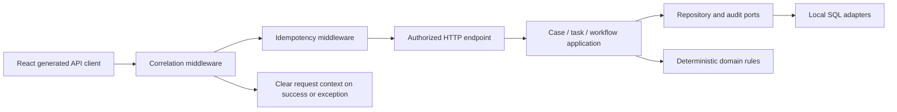

# Requested task-area integration

Date: 2026-09-08

## Scope and ownership

Four native Codex subagents use `gpt-5.6-luna` with medium reasoning.
The user's explicit instruction excludes Orca execution for this work.
The repository's remaining architectural and verification rules still apply.

| Agent | Requested task areas |
| --- | --- |
| Goodall | T013 intake; T022 idempotency; T070 workflow startup; T077 seed |
| Boole | T036 telemetry; T042 demo documentation; T038 tenant-isolation tests; T057 document HTTP routing |
| Socrates | T051–T052 case experience; T061–T062 task application/API; T065 task UI |
| Fermat | T068 SLA domain; T078 SLA worker; T073 workflow publication; T075 admin API; T079 read-only admin UI |

The coordinator owns shared application composition, frontend routes, generated
OpenAPI types, and integration verification. Existing uncommitted work is
preserved. A task is assessed against its acceptance criteria before any claim
of completion; an unchecked task entry alone does not prove implementation is
missing.

## Explicit exclusions

This work does not implement or modify participants (T046–T049), document
download application behavior (T056), the document upload UI (T064), or the
case transitions panel (T080). Existing implementations of those capabilities
are preserved. T057 may route to existing download behavior without changing
that excluded application implementation.

## Shared request composition

The full module map, domain relationships, mutation sequences, guard evaluation
trace, and Azure seam inventory remain in [architecture.md](../architecture.md).
Correlation runs before replay so early HTTP responses receive a request
correlation header. Request-context cleanup occurs in `finally` so handler
failures cannot leave stale actor or tenant values in the current context.

## Verification baseline

Before integration, backend lint/formatting, strict domain/application typing,
and frontend typechecking passed. The existing frontend suite passed 36 tests.
The backend suite passed 1,070 tests, but its coverage report failed because
concurrent test invocations shared `.coverage`; this is not a valid coverage
measurement. Subsequent coverage runs use a dedicated `COVERAGE_FILE`.

The existing interface-to-infrastructure import contract fails in unrelated
routers. Domain purity and application import contracts pass. Those pre-existing
violations are not grounds to weaken the contract or expand this task into
unrelated feature work.
