# Admin workspace increment — November 7, 2026

## Context and decision

The administration workspace exposes existing reporting and role APIs. The report studio compiles a documented SQL-style COUNT/GROUP BY grammar into the existing declarative reporting definition. Supported case fields are status, priority, and workflow_state. Arbitrary SQL, joins, and custom expressions need a separately designed backend query service. The UI states its grammar and process-lifetime definition storage.

Bulk assignments apply at most 50 independent role mutations. Preview freezes the role, operation, and users. Partial results remain visible and retry resubmits failed users only. Each request retains the existing server-side authorization, tenancy and audit behavior.

## Module map and flow

ReportStudio uses reportStudio.ts, generated contracts, reportQuery.ts, and existing report render/export routes. BulkRoles uses the shared roles client. AdminHome supplies route navigation. A separate local Vite instance on 5175 selects the synthetic process_admin actor at the proxy.

```mermaid
flowchart LR
  Admin[Administrator] --> Studio[Report studio]
  Admin --> Bulk[Bulk assignments]
  Studio --> Grammar[Supported query compiler]
  Grammar --> Definition[Report definition API]
  Definition --> Scope[Tenant and team scoped repositories]
  Studio --> Export[Audited CSV export]
  Bulk --> RoleAPI[Authorized role mutations]
  RoleAPI --> Outcomes[Per-user results and retries]
```

## Consequences and integration seam

The administrator can demonstrate actual report results and assignment changes. Definitions use the existing process-local repository and disappear on API restart. Durable definition persistence, a user directory with names, scheduled report delivery, a general SQL service and richer report expressions remain follow-up work. Azure integrations remain adapter seams.
