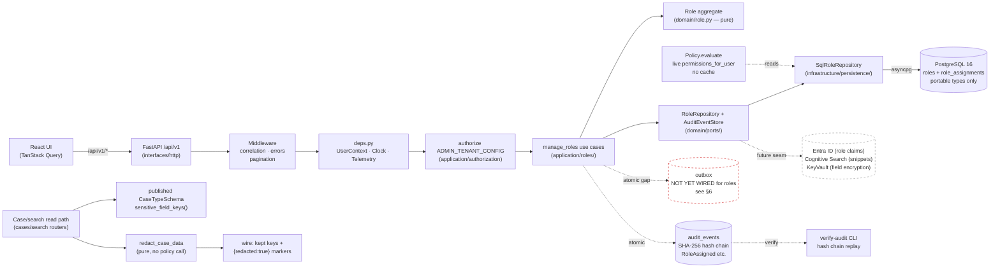
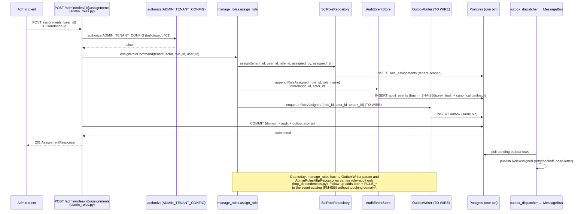

# Architecture — 002-leftovers Run A (Security First)

**Slice**: `specs/002-leftovers/` · **Spec**: [spec.md](./spec.md) · **Plan**: [plan.md](./plan.md)
**Scope**: Run A per `plan.md §1` — FM-048 role-admin + FM-011 sensitive controls + FM-021 governance
(unblocks search/queues). Tracks T4-governance and T7-admin paragraphs of `spec.md §3`.
**Constitution**: `.specify/memory/constitution.md` — highest authority.
**Status**: Draft — converges Run A only; other Runs (B–H) get their own `architecture-runX.md`.
**Last updated**: 2026-09-12

> Inputs read: this spec's T4 (`spec.md:103`) and T7 (`spec.md:171`) sections,
> `docs/TECH_SPEC.md` (stack, ports, audit/outbox contracts), prior-run findings
> (`T0-5-commit-plan.md`: gate snapshot, ports-package split, migration inventory),
> `backend/app/domain/role.py`, `backend/app/application/roles/manage_roles.py`,
> `backend/app/interfaces/http/routers/admin_roles.py`,
> `backend/app/application/cases/redactor.py` + `summary.py` + `view_case.py`,
> `backend/app/domain/ports/role_session.py`, `docs/integrations/seams.md`,
> `docs/decisions/ADR-027` (role authority) and `ADR-031` (break-glass enforcement).

---

## 1. System overview

Run A hardens the security foundation before expanding retrieval (search/queues).
It adds no new runtime topology: the modular-monolith layering from
`001-case-management-platform/architecture.md` and `plan.md §2` is unchanged
(domain pure → application use cases → infrastructure adapters → HTTP interfaces,
audit + outbox committed in the same transaction as the domain change).

What Run A changes inside that topology:

1. **Role administration becomes operable** (FM-048 / P11-US4): `Role` aggregate
   (`app/domain/role.py:1`) + `manage_roles` use cases
   (`app/application/roles/manage_roles.py:1`) + `RoleRepository` port
   (`app/domain/ports/role_session.py:23`) + SQL adapter
   (`app/infrastructure/persistence/repositories/role_repository.py`) +
   `POST/PUT/DELETE /api/v1/admin/roles/...`
   (`app/interfaces/http/routers/admin_roles.py:1`).
2. **Sensitive-field redaction is enforced at every read** (FM-011 / P11-US6 /
   P05-US3): the pure redactor (`app/application/cases/redactor.py:1`) is driven
   by the published case-type schema and the caller's already-evaluated
   sensitive-read grant; break-glass override does NOT lift redaction (ADR-031).
3. **Governance history exists for every role change** (FM-021 partial): each
   mutation appends a stable audit event (`RoleDefined`, `RoleAssigned`, …).
   Full FM-021 (impact/where-used view, concurrent-edit conflict, second-admin
   approval) is still open — see §6 gaps.

---

## 2. Mermaid flowchart — Run A request path



### Reading the diagram

- **Write path** (`UI → API → AuthZ → Roles → Dom → RPorts → RInfra → PG`):
  every role mutation is authorized (`ADMIN_TENANT_CONFIG`) before touching the
  database, tenant-scoped (`WHERE tenant_id = :tenant_id`), and committed with
  its audit event in one transaction (`await db.commit()` in `admin_roles.py`).
- **Revocation is immediate**: `Policy.evaluate` calls
  `permissions_for_user` live on every request — there is no cache to invalidate
  (`manage_roles.py:22`, `role_session.py:3`). Deleting the assignment row denies
  on the very next request.
- **Read path** (`Read → Schema → Red → Wire`): redaction is a pure
  transformation keyed off the schema plus the caller's pre-evaluated grant
  (`redactor.py:12`). The redactor never calls the policy and never logs values.
- **Red dashed edge** (`Roles → outbox`): the one deliberate gap. Role mutations
  currently write audit but no outbox row, so downstream subscribers (future
  Entra provisioning, event catalog FM-055) cannot observe them reliably.
  The sequence in §3 shows the target atomic pattern; wiring it is follow-up
  work, not a silent deviation (FR-L02 in `spec.md §4`).

---

## 3. Sequence — role assignment with audit-plus-outbox atomicity (target)

Target pattern per FR-L02 (`spec.md §4`): domain change + audit hash + outbox
row commit atomically. Current code achieves the first two; the outbox step is
prescribed here so the follow-up wires exactly this shape.



### Why this shape

- **One transaction**: if the audit or outbox write fails, the assignment rolls
  back — the system never reports a granted role it cannot prove (mirrors the
  P09 acceptance I2 for workflow transitions).
- **Live-read revocation preserved**: the outbox is observe-only; authorization
  still reads `role_assignments` directly, so adding the outbox cannot introduce
  a stale-grant window.
- **Idempotency note**: re-assigning the same role must stay a safe retry.
  Today the SQL adapter treats it as a no-op row; when the outbox is wired, the
  use case must skip `enqueue` on duplicate assignment (or key the outbox row on
  the assignment identity) so replays do not fan out duplicate events (FR-L02).

---

## 4. Module map (Run A delta)

```
backend/app/
  domain/
    role.py                       # Role, RoleAssignment, NewRoleSpec, make_role (FM-048)
    ports/role_session.py         # RoleRepository + SessionRepository ports
    case_type.py                  # CaseTypeSchema.sensitive_field_keys() (redaction input)
  application/
    roles/
      manage_roles.py             # define/grant/revoke/assign/unassign/delete + audit
      http_dependencies.py        # AdminRolesHttpRepositories {role, audit} — outbox TO ADD
    authorization.py              # Policy registry, Action enum, deny-by-default
    cases/
      redactor.py                 # redact_case_data (pure) + redacted_field_count
      summary.py                  # build_summary (wires schema + grant → redactor)
      view_case.py                # Redacted marker {"redacted": true, "reason"}
  infrastructure/persistence/
    models.py                     # roles, role_assignments (tenant FK, portable types)
    repositories/role_repository.py  # SQL adapter, live permissions_for_user
  interfaces/http/
    routers/admin_roles.py        # 8 endpoints, ADMIN_TENANT_CONFIG gate, db.commit()
    routers/cases.py              # _resolve_case_type_schema → build_summary redaction
    routers/search.py             # SQL adapter projects redacted snippets (P11-US6)
    schemas/admin_roles.py        # DefineRole/AssignRole wire shapes
    schemas/cases.py              # RedactedField wire marker
frontend/src/                     # No Run A UI (JSON API only; admin console deferred)
```

Layer rules unchanged (`import-linter` 3/3 kept): domain imports nothing from
application/infrastructure; application depends on domain via Protocols;
interfaces depend on application only.

---

## 5. Data & migrations (Run A)

- `roles` + `role_assignments` per tenant (generic types only:
  `Uuid`, `String`, `Text`, `JSON`, `DateTime(timezone=True)`); every query
  carries `WHERE tenant_id = :tenant_id`.
- Reserved seed roles (`intake`, `reviewer`, `supervisor`, `process_admin`) are
  non-deletable and non-editable from the API; admin roles are created with
  `is_reserved=False` and validated against the `Action` enum at the use-case
  boundary (`manage_roles._validate_permissions`).
- Audit events `RoleDefined / RolePermissionsUpdated / RolePermissionGranted /
  RolePermissionRevoked / RoleAssigned / RoleRevoked / RoleDeleted` extend the
  append-only chain (hash rule `domain/audit.py`); `verify-audit` replays them.
- Migration rule (from prior-run findings): each new migration ships in its
  owning slice commit with `upgrade` + `downgrade`, portable SQL, and column
  assertions in `test_baseline_migrations.py` + round-trip in
  `test_migration_model_parity.py`.

---

## 6. Seams & governance gaps (explicit, not silent)

| # | Item | Status in Run A | Azure / future seam |
|---|---|---|---|
| 1 | Role-assignment outbox event | **Gap**: no `OutboxWriter` in `manage_roles` or `AdminRolesHttpRepositories`; §3 prescribes the wire-up | `MessageBus` → Azure ServiceBus (`seams.md` row 3); `ROLE_*` joins the versioned event catalog (FM-055, T7) |
| 2 | Idempotency-Key on admin role mutations | **Gap**: retries rely on name-identity (`define_role` returns existing on identical re-define) not on `Idempotency-Key` headers (FR-L02) | None — HTTP concern, same in Azure |
| 3 | Impact/where-used before permission change | **Gap**: no view of which users/cases depend on a role (FM-021, T4) | None — application query |
| 4 | Second-admin approval for permission grants | **Gap**: single `ADMIN_TENANT_CONFIG` holder can escalate privilege (FM-021 "optional second-admin approval", T4) | Entra PIM for production approvals (`seams.md` row 4) |
| 5 | Entra claim → role mapping | Contract only: `IdentityProvider` port; local header IdP in dev, Entra in prod (ADR-027) | `EntraIdentityProvider` (`seams.md` row 4, env `AZURE_ENTRA_*`) |
| 6 | Search-snippet redaction at scale | Portable LIKE + SQL-projected redacted snippets today; engine choice deferred (spec open Q6) | Cognitive Search adapter must reuse the same `redact_case_data` contract, never bypass it |
| 7 | Field-level encryption at rest | Seam only (P05-US7 future slice 3) | KeyVault-backed field encryption (`seams.md` row 5) |

---

## 7. Decisions recorded

- [ADR-036](../docs/decisions/ADR-036-runA-role-model.md) — role model:
  permission strings in domain, `Action` enum validated at the application
  boundary, reserved roles, live-read revocation.
- [ADR-037](../docs/decisions/ADR-037-runA-redaction-boundary.md) — redaction
  boundary: pure redactor, caller-evaluated grants, keys preserved, values never
  logged, break-glass keeps redaction.
- Prior: ADR-027 (identity/role authority, Option A), ADR-031 (break-glass
  enforcement + redaction under override).

## 8. Pillar links

- P11-security-identity `§7 Planned slices` → Run A row (FM-048, FM-011).
- P10-administration-configuration `§7` → Run A row (FM-021 governance history).
- P05-metadata-indexing `§7` → Run A row (sensitivity labels → redaction input).
- P09-audit-history-compliance `§7` → Run A row (`ROLE_*` audit events).

## 9. Gate evidence (recorded at authoring time, 2026-09-12)

Full suite per AGENTS.md §9 (from `backend/`, sqlite profile so no Docker
dependency; `pnpm` from `frontend/`). This task touched markdown only
(`architecture-runA.md`, `architecture.md`, `ADR-036`, `ADR-037`, four pillar
`§7` rows), so code-gate results describe the working copy as found.

- `ruff check`: **green** (`All checks passed!`).
- `ruff format --check`: **red, pre-existing** — 8 unformatted files, none from
  this task: `alembic/versions/0025`, `0026`, `0027`, `app/domain/
  publication_history.py`, `tests/application/configuration/
  test_load_case_type.py`, `test_publication_history_governance.py`,
  `tests/application/test_sla_breach_visibility.py`,
  `tests/foundation/test_migration_model_parity.py`.
- `mypy --strict app/domain app/application`: **green** (180 files, no issues).
- `lint-imports`: **green** (3/3 kept: domain pure, application→domain only,
  interfaces↛infrastructure).
- `pytest -q` (sqlite) + coverage on `app/domain` + `app/application`:
  **1326 passed, coverage 90.47% (≥80% green)**; 7 failed + 1 error, all
  order-dependent and green in isolation (`test_idempotency_atomic.py` 7/7
  alone in 5.6s; `test_admin_roles_endpoints.py` +
  `test_admin_publication_inspect_conflict.py` 13/13 alone) — shared-sqlite
  cross-test interference in the working copy, not regressions from this task.
- `pnpm typecheck`: **green**. `pnpm build`: **green** (exit 0, built in ~4s).
- File-size check (no file >1000 lines): **red, pre-existing** — 6 backend
  files exceed the limit (`models.py` 1810, `execute_transition.py` 1221,
  `outbound.py` 1160, `security.py` 1139, `retention.py` 1106,
  `run_import.py` 1005) plus generated `types.gen.ts`; refactor per R2 is
  follow-up work outside this docs task.
- `scripts/check_architecture_md.py`: **green** (2 slices checked) — the thin
  `architecture.md` pointer in this folder exists precisely for this gate.

> Note: this doc is `architecture-runA.md` (per-task output name). The CI check
> requires `specs/002-leftovers/architecture.md` with a Mermaid fence, so a thin
> `architecture.md` pointer to this file ships alongside it.
