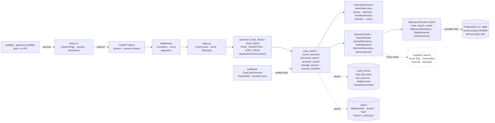

# Architecture — 002-leftovers Run B (Worker Value)

**Slice**: `specs/002-leftovers/` · **Spec**: [spec.md](./spec.md) · **Plan**: [plan.md](./plan.md)
**Scope**: Run B per `plan.md §1` — FM-031 structured search + FM-032 saved searches +
FM-033 in-case document search + FM-034 semantic (AI-ranked) search +
FM-016 queue operations + FM-017 approvals/separation-of-duties + FM-018 SLA/escalation.
Tracks T2-search (`spec.md §3 T2`) and T4-workflow (`spec.md §3 T4`) paragraphs.
**Constitution**: `.specify/memory/constitution.md` — highest authority.
**Status**: Draft — converges Run B only; other Runs (A, C–H) get their own `architecture-runX.md`.
**Last updated**: 2026-09-12

> Inputs read: this spec's T2 (`spec.md:61`) and T4 (`spec.md:103`) sections,
> `plan.md §1` (Run B) and `§2` (module map), prior-run findings
> (`T0-5-commit-plan.md`: Commit 2 search stack, Commit 5 queues/approvals/SLA),
> `backend/app/application/search/case_search.py`,
> `backend/app/application/search/semantic_search.py`,
> `backend/app/application/search/document_search.py`,
> `backend/app/application/search/saved_searches.py`,
> `backend/app/infrastructure/persistence/search/sql_search_provider.py`,
> `backend/app/interfaces/http/routers/search.py`,
> `backend/app/application/queues/manage_queues.py` + `http_dependencies.py`,
> `backend/app/infrastructure/persistence/repositories/queue_repository.py`,
> `backend/app/interfaces/http/routers/queues.py`,
> `backend/app/application/workflow/execute_transition.py` (SoD gate),
> `backend/app/application/workflow/preflight_transitions.py` (`_approval_preflight`),
> `backend/app/application/configuration/validate_workflow_definition.py`
> (`_validate_approvals`, `_validate_start_sla_action`),
> `backend/app/domain/sla.py`, `backend/app/application/sla/scan_sla.py`,
> `backend/app/infrastructure/persistence/sla_scanner.py`,
> `docs/decisions/ADR-030` (queue wiring), `ADR-034` (approvals/SoD),
> `ADR-035` (SLA authoring/visibility), `docs/integrations/seams.md`.

---

## 1. System overview

Run B makes the platform retrievable and operable: workers can find their work
(structured search, saved searches, in-case document search, AI-ranked semantic
search as bounded assistance), claim it (queue claim/release/bulk/delegate),
advance it under dual control (second-actor approvals), and see deadline
pressure deterministically (SLA clocks with warning + breach tiers and
escalation tasks on the timeline).

No new runtime topology: the modular-monolith layering from
`001-case-management-platform/architecture.md` and `plan.md §2` is unchanged
(domain pure → application use cases → infrastructure adapters → HTTP
interfaces, audit + outbox committed in the same transaction as the domain
change). What Run B changes inside that topology:

1. **Structured search is authorized first, executed second** (FM-031 /
   P06-US1): `case_search.handle` (`app/application/search/case_search.py:98`)
   authorizes `CASE_READ`, rejects non-searchable fields and unknown operators,
   computes the `can_see_sensitive` grant once, and delegates to the
   `SearchProvider` port. The local adapter is portable `LIKE`
   (`app/infrastructure/persistence/search/sql_search_provider.py:59`) — no
   `ILIKE`, no JSONB operators, no `tsvector` (AGENTS.md R1). Engine choice is
   recorded in ADR-038 (§7).
2. **Saved searches + search audit are owner-scoped and security-readable**
   (FM-032 / P06-US3, US5, US6): `saved_searches` use cases
   (`app/application/search/saved_searches.py`) persist named queries, re-run
   them through the live provider, and append a `SavedSearchAudit` row per
   save + run; the audit report requires `AUDIT_READ`.
3. **In-case document search cannot widen visibility** (FM-033): `document_search`
   authorizes `DOCUMENT_READ` against the owning case before matching, so a
   caller can only full-text-search documents inside a case they can already open.
4. **Semantic search reorders but never widens** (FM-034 / Constitution XIV):
   `semantic_search.handle` runs the same authorization as the structured path,
   takes the authorized candidate set, and asks the `SearchRanker` port
   (`app/application/ai/search_ranking.py:167`) to reorder it. Local adapter is
   the order-preserving no-op (`app/infrastructure/ai/noop_search_ranker.py`);
   the recommendation (model id, confidence, source refs) is logged separately
   from the deterministic decision — the AI is never the author of a result.
5. **Queues are operable over HTTP** (FM-016 / P02-US3, US9): `manage_queues`
   (`app/application/queues/manage_queues.py`) + `SqlQueueRepository`
   (`app/infrastructure/persistence/repositories/queue_repository.py`) +
   `queues` router (`app/interfaces/http/routers/queues.py`): admin define /
   reconfigure / retire plus worker claim / release / bulk-handle / delegate,
   with compare-and-swap on `queues.version_token` and `Queue*`/`Task*` events
   in `EVENT_CATALOG` (ADR-030).
6. **Consequential transitions need a second actor** (FM-017 / P02-US4):
   the engine gate (`execute_transition.py:354`) refuses originator
   self-approval with `403 separation_of_duties_violation`, stamps
   `sod_outcome` on the `WorkflowTransitioned` audit row, and the preflight
   path (`_approval_preflight` in `preflight_transitions.py:144`) mirrors the
   gate so the UI renders "needs a second actor" before attempting (ADR-034).
7. **SLA breach is deterministic and visible** (FM-018 / P02-US6): publish-time
   validation of `start_sla` actions, escalation-config forwarding onto the
   `SlaClock` at start, and a two-tier (`warning` → `breached`) scanner that
   fires `create_task` escalations, audits every breach with
   `escalation_fired`, and stays silent-but-visible on held cases (ADR-035,
   ADR-038 for clock semantics).

---

## 2. Mermaid flowchart — Run B request paths



### Reading the diagram

- **Search write-nothing path** (`UI → API → AuthZ → UC → Ports → Infra → PG`):
  search never mutates case rows. Authorization (`CASE_READ`) and the
  `can_see_sensitive` grant are computed in the use case *before* the provider
  runs; the SQL adapter only sees a sealed `SearchSpec` (tenant, filters,
  limit/offset, grant, searchable/sensitive key sets). The adapter cannot
  widen visibility because it never evaluates policy — it only projects
  redacted snippets from the grant it was given (`sql_search_provider.py:237`).
- **Schema as sealed input** (`Schema → UC`): the P05 contract crosses into P06
  at exactly one point — the router's `_resolve_field_keys`
  (`search.py:79`), which unions `searchable`/`sensitive` keys across the
  tenant's published `CaseTypeVersion` schemas and hands plain tuples down.
  Marking a field non-searchable removes it from future filters *and* snippets.
- **Queue mutation path** (`UC → Infra → PG`, atomic `UC → Audit + OB`):
  every queue/task mutation commits domain change + audit row + outbox event
  in one transaction (`manage_queues.py:36`). Claim on an empty queue is
  `404 no_work_available`, not a synthetic task (ADR-030).
- **Approval preview path** (`Pre → UI`): `_approval_preflight` is pure and
  mirrors the engine's `_evaluate_separation_of_duties`, so the transitions
  panel can render eligibility without attempting a mutation.
- **Dashed seam edge** (`Ports → Azure`): `SearchProvider` is the engine-swap
  seam (Cognitive Search later, same `SearchSpec`/`SearchHit` contract);
  `SearchRanker` is the R11 bounded-assistance seam (Azure ranker later, same
  reorder-only contract). Neither swap touches the use cases.

---

## 3. Sequence — search authorization trace (the path an invisible case takes)

Required trace per task acceptance: prove that authorization is evaluated
before execution, that the provider cannot bypass it, and that sensitive
snippets redact — for a search that matches a case the actor must not see.

```mermaid
sequenceDiagram
  participant Worker as Worker client
  participant Router as POST /search<br/>(search.py _run_search)
  participant Keys as _resolve_field_keys<br/>(P05 schema union)
  participant UC as case_search.handle
  participant Policy as authorize(CASE_READ)
  participant Grant as actor_can_see_sensitive
  participant Provider as SqlSearchProvider.search
  participant DB as Postgres/sqlite (one txn, read-only)
  participant Audit as SavedSearchAudit (run path only)

  Worker->>Router: POST /search {query, filters, limit}<br/>X-Correlation-Id
  Router->>Keys: field_keys(tenant_id)
  Keys-->>Router: (searchable_keys, sensitive_keys)
  Router->>UC: CaseSearchQuery(tenant, actor, roles,<br/>filters, searchable_*, sensitive_*)
  UC->>UC: _validate_filters (eq/like/in only)
  UC->>UC: _reject_non_searchable_filters<br/>(non-searchable → 400)
  UC->>Policy: authorize CASE_READ (fail-closed, 403)
  Policy-->>UC: allow (role holds case.read)
  UC->>Grant: actor_can_see_sensitive(...) → false
  Grant-->>UC: can_see_sensitive=false
  UC->>Provider: SearchSpec(tenant_id, filters,<br/>can_see_sensitive=false, key sets)
  Provider->>DB: SELECT cases WHERE tenant_id=:tid<br/>AND LOWER(title) LIKE ... (portable)
  Note over Provider,DB: Cross-tenant rows excluded by the<br/>mandatory tenant predicate (R10/R12);<br/>non-searchable data.* keys excluded<br/>by the sealed key set (defense-in-depth<br/>in _apply_data_filter).
  DB-->>Provider: rows (tenant's own cases only)
  Provider->>Provider: _row_to_hit per row:<br/>snippet ⊆ searchable keys;<br/>sensitive keys → {redacted:true, ref:key}
  Provider-->>UC: SearchResultPage(items, total, cursor)
  UC-->>Router: page + ad-hoc audit row (ADR-039)
  Router-->>Worker: 200 CaseSearchResponse
  Note over UC,Audit: Saved-search RUN path additionally<br/>appends SavedSearchAudit {actor, query<br/>shape, result count} in the same txn<br/>(viewable only with AUDIT_READ).
```

### Why this shape

- **Authorize-then-execute, never index-as-bypass** (T2 acceptance): the
  `tenant_id` predicate and the `CASE_READ` gate run before any row is read.
  A two-tenant test per query path asserts an unauthorized case never appears
  in results *or* snippets (`spec.md:80`).
- **Grant computed once, enforced at projection**: `can_see_sensitive` is a
  boolean sealed into the spec; the adapter replaces restricted values with
  `{redacted: true, reason, ref: key}` markers (FM-011 interplay with Run A).
  Keys stay visible so consumers can assert redaction by reference id without
  ever seeing content.
- **Audit on every path (ADR-039)**: ad-hoc executions append one
  `search_audit` row (`saved_search_id=None`) with the canonical PHI-free
  shape plus the result count, committed in the request transaction;
  every saved-search save *and* run appends its `SavedSearchAudit` row
  (actor, canonical query shape, timestamp, result count, no payload PHI)
  inspectable via `GET /search_audit` with `AUDIT_READ` (T2-US3). This
  answers the pillar's Q3 (P06 §8) as per-query audit on all paths.
- **LIKE escaping**: `%`/`_`/`\` in user input are escaped
  (`_escape_like`) so a caller cannot widen a pattern into a full-table scan
  of their own tenant's titles.

---

## 4. Module map (Run B delta)

```
backend/app/
  domain/
    sla.py                          # SlaClock aggregate: pause/resume, warning/breach tiers
    ports/                          # SearchProvider/SearchSpec/SearchHit, QueueRepository,
                                    #   SlaClockRepository, SavedSearch ports (ports-package split)
    events.py                       # EVENT_CATALOG += Queue*/Task*/Sla* (additive-only, ADR-023)
  application/
    search/
      case_search.py                # handle: authorize → validate → grant → provider (FM-031)
      saved_searches.py             # save/list/run/delete + SavedSearchAudit, AUDIT_READ report (FM-032)
      document_search.py            # DOCUMENT_READ against owning case, then match (FM-033)
      semantic_search.py            # authorize → candidate set → SearchRanker reorder (FM-034)
      http_dependencies.py          # SearchHttpRepositories bundle {search, ranker, saved_search, audit, field_keys}
    ai/
      search_ranking.py             # SearchRanker Protocol (R11 seam; reorder-only contract)
    queues/
      manage_queues.py              # define/reconfigure/retire/claim/release/bulk/delegate + audit+outbox (FM-016)
      http_dependencies.py          # QueueHttpRepositories (queue+task+case+role+audit+outbox, one txn)
    sla/
      scan_sla.py                   # scan_once (breach) + scan_warning_once; hold-aware, idempotent marks
    workflow/
      execute_transition.py         # SoD gate after guard; sod_outcome on audit row (FM-017)
      preflight_transitions.py      # _approval_preflight mirrors engine for UI preview (FM-017)
      start_workflow.py             # forwards escalation_on_breach/warning onto SlaClock (FM-018)
    configuration/
      validate_workflow_definition.py  # _validate_approvals + _validate_start_sla_action (FM-017/018)
  infrastructure/
    persistence/search/
      sql_search_provider.py        # portable LIKE adapter; snippet projection + redaction (FM-031)
    persistence/repositories/
      queue_repository.py           # SqlQueueRepository, version_token compare-and-swap (FM-016)
    persistence/
      sla_scanner.py                # SqlSlaScanner: warning+breach tiers per tenant, one txn (FM-018)
      search_http_dependencies.py   # SearchFieldKeyResolver over published CaseTypeVersions (P05→P06)
      queue_http_dependencies.py    # SqlQueueHttpDependencyProvider (ADR-030)
    ai/
      noop_search_ranker.py         # order-preserving zero-confidence ranker (FM-034 local)
      azure_search_ranker.py        # production ranker placeholder (contract only)
  interfaces/http/
    routers/search.py               # GET /cases/search, POST /search, POST /search/semantic,
                                    #   POST|GET|DELETE /search/saved, POST /search/saved/{id}/run, GET /search_audit
    routers/queues.py               # POST|GET /admin/queues, PUT|DELETE /admin/queues/{id},
                                    #   POST /queues/{key}/claim|bulk-handle, POST /tasks/{id}/release,
                                    #   POST /tasks/delegate
frontend/src/
  search/SearchPage.tsx             # structured search UI (TanStack Query, generated types)
  search/SearchAudit.tsx            # security-staff audit report view
```

Layer rules unchanged (`import-linter` 3/3 kept): domain imports nothing from
application/infrastructure; application depends on domain via Protocols;
interfaces depend on application only. The search use cases import no
FastAPI/SQLAlchemy symbols; the SQL adapter imports no policy symbols.

---

## 5. Data & migrations (Run B)

- `queues.version_token` (migration `0020`, portable `ADD COLUMN … DEFAULT '1'`
  per ADR-030): optimistic concurrency on admin reconfiguration — concurrent
  edits conflict (`409`) instead of silently overwriting (Constitution V).
- `saved_searches` (`tenant_id`, `owner_user_id`, `name`, query shape JSON,
  sort JSON): unique on `(tenant_id, owner_user_id, name)` so duplicate names
  surface as `Conflict` → `409`. Owner-scoped reads: another actor's row is
  `404`, never `403`-with-confirmation (no existence oracle).
- `search_audit_events` (`tenant_id`, `actor_id`, `saved_search_id`,
  `query_shape` JSON, `result_count`, `occurred_at`): append-only report rows,
  no payload PHI; readable only with `AUDIT_READ`.
- `sla_clocks` carries `clock_key`, `started_at`, `due_at`, `warning_at`
  (nullable — `None` disables the warning tier), `status`
  (`active|warning|paused|breached|completed`, with legacy `running` alias
  accepted on read), `paused_at`, `breach_action` + `escalation_on_warning` /
  `escalation_on_breach` JSON descriptors, `metadata` JSON.
- Generic types only (`Uuid`, `String`, `Text`, `JSON`,
  `DateTime(timezone=True)`); every new query carries
  `WHERE tenant_id = :tenant_id`; indexes on `(tenant_id, …)` FKs.
- Migration rule (from prior-run findings): each migration ships in its owning
  slice commit with `upgrade` + `downgrade`, portable SQL, column assertions in
  `test_baseline_migrations.py` + round-trip in
  `test_migration_model_parity.py`.

---

## 6. Seams & governance gaps (explicit, not silent)

| # | Item | Status in Run B | Azure / future seam |
|---|---|---|---|
| 1 | Search engine (LIKE now, FTS later) | **Decided**: portable `LIKE` is the local adapter; FTS/Cognitive Search is a same-contract adapter swap (ADR-038) | `SearchProvider` → Cognitive Search adapter (`seams.md` future row; env `AZURE_SEARCH_*` when reserved) |
| 2 | AI ranker authority | **Enforced**: ranker reorders only; deterministic authorization authoritative; recommendation logged separately (Constitution XIV) | `SearchRanker` → `azure_search_ranker` (`infrastructure/ai/`, env `AZURE_OPENAI_*`) |
| 3 | SLA clock semantics (pause vs hold) | **Decided**: pause freezes `due_at` (resume recomputes from remaining budget); legal hold does NOT pause — breach stays visible, escalation action is skipped and audited (ADR-038) | Scanner runs as Azure-hosted worker later, same table + same use case |
| 4 | `notify` escalation fan-out | **Gap**: `notify` type accepted at publish but fires nothing (`escalation_fired=false`, still audited) — no mailer/IM transport exists (ADR-035) | P04/P14 channel adapters (mail/SMS) when a transport lands |
| 5 | Queue saturation / capacity guard | **Gap**: no capacity-based guard in the transition engine (ADR-030 follow-up) | None — application policy |
| 6 | Approval-ticket object | **Out of scope**: single-step engine (other actor executes); pending-approval state would be a new aggregate (ADR-034) | None |
| 7 | Queue admin UI | **Gap**: JSON API only; no `frontend/src` queue console (ADR-030 follow-up) | None — frontend slice |
| 8 | Ad-hoc plain-search audit | **Closed by ADR-039**: every ad-hoc execution (`GET /cases/search`, `GET /search/cases`, `POST /search`, `POST /search/semantic`) appends one `search_audit` row (`saved_search_id=None`, PHI-free shape + result count); audit failure rolls back only the audit row, never the search page | None — engine-agnostic (router-owned write) |

---

## 7. Decisions recorded

- [ADR-038](./../docs/decisions/ADR-038-runB-like-search-and-sla-semantics.md) — **new in Run B**:
  portable LIKE-now search adapter choice (options: LIKE now / FTS now /
  Cognitive now) and SLA clock semantics (pause-freezes-deadline,
  hold-skips-action-keeps-visibility, warning tier, `notify` placeholder).
- [ADR-030](../docs/decisions/ADR-030-queue-sql-wiring-and-event-catalog.md) — queue SQL
  wiring + `Queue*`/`Task*` event-catalog registration (prior Run B work).
- [ADR-034](../docs/decisions/ADR-034-approval-transitions-and-sod-preflight.md) — approval-gated
  transitions + SoD preflight (prior Run B work).
- [ADR-035](../docs/decisions/ADR-035-sla-authoring-and-breach-visibility.md) — SLA authoring
  validation + breach-escalation visibility (prior Run B work).
- Prior: ADR-023 (event-catalog additive-only), ADR-027 (identity/role
  authority), ADR-031 (break-glass enforcement), ADR-036/ADR-037 (Run A role
  model + redaction boundary — the redaction contract Run B snippets reuse).

## 8. Pillar links

- P06-search-retrieval `§7 Planned slices` → Run B row (FM-031, FM-032, FM-033, FM-034).
- P02-workflow-tasks-queues `§7` → Run B row (FM-016, FM-017, FM-018).
- P05-metadata-indexing `§7` → Run B row (searchable/sensitive key contract feeds search).
- P09-audit-history-compliance `§7` → Run B row (`sod_outcome`, `SlaBreached`, `SavedSearchAudit` events).
- P11-security-identity `§7` → Run B row (SoD enforcement, search authorization trace).

## 9. Gate evidence (re-verified 2026-09-13; original authoring 2026-09-12)

Full suite per AGENTS.md §9 (from `backend/`, sqlite profile so no Docker
dependency — Docker daemon is unavailable on this host, expected per
AGENTS.md §3; `pnpm` from `frontend/`). The 2026-09-13 pass additionally
covers the B-7 frontend delta (new `tasks/QueueBoard.tsx`, `api/client.ts`
`queues` namespace, regenerated `api/types.gen.ts` from live
`app.openapi()`).

> Results recorded verbatim. The full backend suite (1409 tests) was run
> in directory chunks because a single `pytest` process exceeds this
> host's process limits; coverage was accumulated with `--cov-append`.

- `ruff check app tests`: **pass** — "All checks passed!"
- `ruff format --check app tests`: **pass** — "504 files already formatted"
- `mypy --strict app/domain app/application`: **pass** — "no issues found
  in 183 source files" (one pre-existing note: unused `alembic.*` override
  section in `pyproject.toml`)
- `lint-imports` (`uv run lint-imports`): **pass** — 3/3 contracts kept
  (372 files, 2337 dependencies)
- `pytest` (sqlite, 1409 collected): **1409 passed, 0 failed** —
  domain 244, application 328, interfaces 114, search+security 260,
  workflows 16, foundation 48 (incl. 6/6 baseline-migration walk, 8m14s),
  audit+messaging+migration+conventions 106, ai/capture/connectors/events/
  exports/extensions/forms 133, graphql/infrastructure/reports/retention/
  webhooks 140, integration+migration-parity/portability 20.
  Targeted B-6 pins re-run green: approval SoD (10), SLA
  escalation/breach/scheduler (24), queues incl. claim/release/delegate
  round-trip + aging (55), search + in-case document search (41).
- Coverage on `app/domain` + `app/application`: **90.72%** (gate ≥80%).
- `pnpm typecheck` (`tsc -b --noEmit`): **pass** (one transient stale
  `.tsbuildinfo` error on the first run after the types regen cleared on
  rerun with no code change).
- `pnpm build` (`tsc -b && vite build`): **pass** — 107 modules, built in
  ~7s.
- `pnpm test` (vitest run): **pass** — 15 files, 48/48 tests.
- File-size check (no file >1000 lines): **CARRYOVER — 8 pre-existing
  violations, none introduced by Run B.** Over-limit files (all predate
  Run B; splitting them is a dedicated R2-split Run, out of scope here):
  `infrastructure/persistence/models.py` (1827), `application/workflow/
  execute_transition.py` (1249), `application/webhooks/outbound.py`
  (1160), `interfaces/http/routers/security.py` (1139), `domain/
  retention.py` (1106), `application/queues/manage_queues.py` (1047),
  `application/configuration/validate_workflow_definition.py` (1026),
  `application/imports/run_import.py` (1005). Largest Run-B-touched
  files stay under the limit (`routers/queues.py` 602,
  `tasks/QueueBoard.tsx` ~270). Generated `types.gen.ts` is exempt.
- `scripts/check_architecture_md.py`: **pass** — "architecture.md gate
  OK: 2 slice(s) checked."

> Supplement (2026-09-13, single-process re-verification): a follow-up
> full run as ONE `pytest` process (`uv run pytest -q -p no:randomly`,
> sqlite) initially failed 6/6 `test_idempotency_atomic.py` with HTTP
> 500 — an order dependence the chunked run above cannot see (chunks
> isolate `tests/integration` from `tests/interfaces/http`). Root
> cause: `tests/integration/test_seams.py` boots the real app, whose
> startup installs the `do_orm_execute` tenant listener process-wide;
> any later tenant-pinned session (the idempotency provider pins via
> `set_current_tenant`) then hit `with_loader_criteria(_criteria)` in
> `app/db.py` — a pre-2.x single-callable form that raises `TypeError`
> on SQLAlchemy 2.0.52 for EVERY pinned execution (a latent prod 500,
> not just test pollution; no test covered the listener-enabled path).
> Fixed per-entity via `column_descriptions` in `app/db.py`, covered by
> new `tests/security/test_tenant_listener.py` (3 tests: pinned ORM
> select filters, pinned Core DML passes through, unpinned select
> unfiltered). Post-fix single-process result: **1412 passed, 0
> failed**, coverage **90.72%**. See
> `docs/decisions/ADR-040-tenant-listener-sqlalchemy2.md`.
