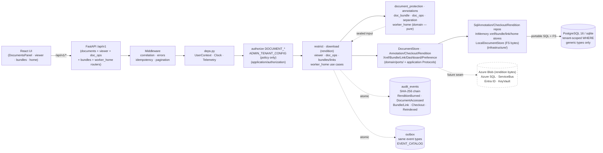
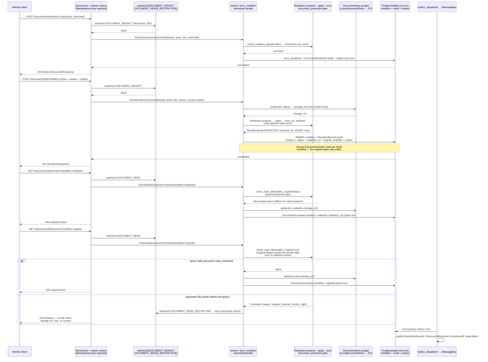

# Architecture — 002-leftovers Run C (Content Depth)

**Slice**: `specs/002-leftovers/` · **Spec**: [spec.md](./spec.md) · **Plan**: [plan.md](./plan.md)
**Scope**: Run C per `plan.md §1` — FM-025 protection/redaction/lock +
viewer pipeline (FM-023 ext) + T5 document operations + worker UX.
Track T5 (`spec.md §3 T5`).
**Constitution**: `.specify/memory/constitution.md` — highest authority.
**Status**: Draft — converges Run C only; other Runs (A–B, D–H) get their own `architecture-runX.md`.
**Last updated**: 2026-09-14

> Inputs read: this spec's T5 (`spec.md:128`) and FR-L01..FR-L08
> (`spec.md:214`), `plan.md §1` (Run C) and `§2` (module map), prior-run
> findings (`T0-5-commit-plan.md`, `architecture-runA.md`,
> `architecture-runB.md`), `backend/app/domain/annotations.py`,
> `backend/app/domain/document_protection.py`,
> `backend/app/domain/doc_bundle.py`, `backend/app/domain/doc_ops.py`,
> `backend/app/domain/separation.py`, `backend/app/domain/worker_home.py`,
> `backend/app/application/documents/viewer.py` +
> `restrict_document.py` + `doc_ops/` package (`__init__` re-export shim
> + `_common` + `xrefs` + `separation` + `packages` + `bundles`) +
> `http_dependencies.py`,
> `backend/app/application/documents/download_document.py`,
> `backend/app/application/worker_home/worker_home.py`,
> `backend/app/domain/ports/viewer.py`,
> `backend/app/infrastructure/persistence/viewer_repository.py` +
> `models_viewer.py` + `viewer_http_dependencies.py` +
> `worker_home_http_dependencies.py`,
> `backend/app/infrastructure/storage/local_document_store.py`,
> `backend/app/interfaces/http/routers/viewer.py` + `doc_bundles.py` +
> `doc_ops.py` + `worker_home.py` + `documents.py` (rendition +
> restrict delta), `backend/alembic/versions/0029_*.py`,
> `docs/decisions/ADR-041` (rendition store) and `ADR-042` (bundle
> permission model), `docs/integrations/seams.md`.

---

## 1. System overview

Run C makes the platform's content layer trustworthy and workable:
workers can protect what is sensitive (restrict / redact / file-lock),
view it in a browser-native pipeline (annotations, revisions,
renditions, checkout, re-index), operate on it (x-refs, separation
plans, packages, hash-dedup, CSV export), share it in bounded ways
(permissioned bundles + share-by-link), and arrange their own home
(dashboard, preferences under an admin policy).

No new runtime topology: the modular-monolith layering from
`001-case-management-platform/architecture.md` and `plan.md §2` is
unchanged (domain pure → application use cases → infrastructure
adapters → HTTP interfaces, audit + outbox committed in the same
transaction as the domain change). What Run C changes inside that
topology:

1. **Document protection is a pure policy kernel** (FM-025 / T5-US1):
   `document_protection.py` (`app/domain/document_protection.py:1`)
   owns the three rules — restriction threshold (`restricted`/`phi`
   need `document.read_restricted`), versioned redaction (original
   preserved, original always under the stricter right), filing lock
   (locked documents refuse every mutation with `DocumentLocked` →
   HTTP 423). `restrict_document` (`application/documents/
   restrict_document.py:1`) flips the label under `DOCUMENT_REDACT`
   auth; `download_document` (`application/documents/
   download_document.py:1`) serves `?rendition=original|redacted`
   through the same gate with per-rendition `DocumentAccessed` audit
   rows. A guessed-URL probe without the grant gets `403` with a
   metadata-free reason code only (T5 acceptance).
2. **Redaction burns as a new rendition; the original is never
   rewritten** (FM-025 / T5-US1): `viewer.burn_rendition` stores the
   burned bytes via the *existing* `DocumentStore.put` port (no new
   byte seam — ADR-041), shapes the row through the domain
   propose/apply/burn flow, and commits rendition row + `RenditionBurned`
   audit + outbox atomically. §3 prescribes the full version sequence.
3. **The viewer is an overlay model** (FM-023 ext / T5-US2):
   annotations (`highlight`/`text_box`/`stamp`/`freehand`) pin to
   `(document_id, document_version, page)` and never touch document
   bytes; checkout is a persistent exclusive lock with holder + expiry
   (`CheckoutConflict` → structured 409 with holder + expiry, T5
   acceptance); revision/rendition history renders as one timeline;
   re-index records a validated request audited as `DocumentReindexed`
   with the rebuild behind the search-index seam.
4. **Document operations are deterministic local computations**
   (T5 doc-ops): x-refs (directed, sortable, never confer access),
   separation plans (split must exactly partition pages; join/merge
   stays in-case — byte surgery itself is a later slice, the plan is
   the auditable contract), packages (manifest-bearing, package digest
   over sorted member digests), hash-dedup (exact-digest groups),
   CSV export (closed column vocabulary, restricted rows drop without
   the stricter grant).
5. **Bundles share through the bundle only** (T5-US3): `DocBundle`
   grants + `ShareLink` bearer tokens (digest-only storage, 5m–30d
   TTL, bounded uses) open a bundle-mediated read path that never
   widens document grants and never becomes a search corpus (ADR-042).
6. **Worker home is per-user config under an admin policy that wins**
   (T5 worker UX): dashboard layout, closed-vocabulary preferences,
   and a tenant policy whose locked values override user values
   (`resolve_effective_preferences` — total, deterministic).

---

## 2. Mermaid flowchart — Run C request paths



### Reading the diagram

- **Protect path** (`UI → API → AuthZ → UC → Dom → Ports → Infra`):
  restriction and rendition downloads evaluate the pure
  `document_protection` gate *before* touching bytes; the policy
  (`DOCUMENT_REDACT`, `DOCUMENT_READ_RESTRICTED`) is the authority and
  the domain strings (`document.read_restricted`) are the contract the
  tests pin. Denials carry safe reason codes only — no file names,
  storage refs, sizes, or content (T5 acceptance: guessed-URL download
  of a restricted doc returns `forbidden` with no metadata leak).
- **Burn path** (`UC → DocumentStore → rendition row → Audit + OB`):
  bytes land first via the reused `DocumentStore.put` (ADR-041), then
  the rendition row, then audit + outbox — all in one transaction, so
  a burn without provenance can never commit. The source
  `DocumentVersion` rows are never modified on this path.
- **Overlay path** (annotations / checkout): writes touch only the
  viewer tables plus audit + outbox; `documents` /
  `document_versions` are read for version bounds at most. A live
  foreign checkout raises `CheckoutConflict` (holder + expiry) before
  any write → HTTP 409 with the structured `conflict` envelope (T5
  acceptance).
- **Bundle path**: grants are checked through `check_bundle_access`
  (cross-tenant → revoked → grant-cover), then the per-document
  sensitivity gate still applies on top — bundle access never bypasses
  `check_read_allowed` for restricted originals (ADR-042).
- **Home path**: dashboard/preference rows are process-local
  singletons (synthetic tenants); audit + outbox stay SQL so every
  mutation remains audit-atomic in the request transaction (FR-L02).
- **Dashed seam edge** (`Ports → Azure`): rendition bytes ride the
  existing Document-store seam (local FS now, `AzureBlobDocumentStore`
  later — no second port); viewer/xref/bundle/home rows are
  same-contract SQL swaps later.

---

## 3. Sequence — redaction-version lifecycle (original preserved, both audited)

Required trace per task acceptance: prove that a redaction creates a
new versioned artifact, that the original stays retrievable only under
the stricter right, that both views are independently audited, and
that a guessed-URL probe learns nothing.



### Why this shape

- **Original-preserved by construction**: the burn path has no UPDATE
  statement against `documents` / `document_versions` — the only write
  targets are the new rendition row plus audit + outbox. The original
  stays retrievable under the stricter right even when the parent is
  merely `internal` (otherwise redaction would be a no-op for
  confidentiality).
- **Two views, two audit rows**: each rendition download appends its
  own `DocumentAccessed` row carrying `rendition` + `redaction_id`,
  so the timeline distinguishes "saw the redacted view" from "saw the
  original bytes" for the same document.
- **Fail-closed denials**: cross-tenant is denied before the grant
  check; the grant check is dual (static permission map for the fast
  path + live `authorize(DOCUMENT_READ_RESTRICTED)` so FM-048 custom
  roles are honoured); denial details carry only the stable reason
  code.
- **Idempotent mutations**: every burn/restrict/annotation/checkout/
  bundle/link endpoint requires `Idempotency-Key`; the
  `IdempotencyMiddleware` replays successful responses under
  `/api/v1`.

---

## 4. Module map (Run C delta)

```
backend/app/
  domain/
    annotations.py                # Annotation, Redaction, Rendition, CheckoutLock,
                                  #   evaluate_edit_lock, resolve_viewer_rendition,
                                  #   ReindexRequest (906 lines, pure)
    document_protection.py        # restriction/redaction/lock policy kernel (258)
    doc_bundle.py                 # DocBundle, ShareLink, BundleRole, token hash (567)
    doc_ops.py                    # DocXref, DocPackage+manifest, dedup, CSV (450)
    separation.py                 # plan_split / plan_join_merge + audit record (444)
    worker_home.py                # DashboardConfig, UserPreferences, PreferencePolicy (314)
    ports/viewer.py               # Annotation/CheckoutLock/RenditionRepository ports (188)
    ports/infrastructure.py       # DocumentStore port (reused for renditions, ADR-041)
  application/
    documents/
      viewer.py                   # annotations/checkout/renditions/re-index use cases (880)
      restrict_document.py        # sensitivity raise under DOCUMENT_REDACT (152)
      doc_ops/                    # R2 split of the former 1359-line module (all <1000):
                                  #   __init__.py (127, re-export shim — routers import
                                  #     the package path unchanged),
                                  #   _common.py (142), xrefs.py (170),
                                  #   separation.py (176), packages.py (226),
                                  #   bundles.py (646, bundles + share links)
      http_dependencies.py        # ViewerHttpRepositories bundle (55)
      download_document.py        # rendition-aware download + dual audit (delta)
    worker_home/
      worker_home.py              # dashboard/preferences/policy use cases + in-mem stores (370)
      http_dependencies.py        # WorkerHomeHttpRepositories bundle
    authorization.py              # += DOCUMENT_READ_RESTRICTED/REDACT/LOCK/ANNOTATE/CHECKOUT/REINDEX (delta)
  infrastructure/
    persistence/
      viewer_repository.py        # SQL adapters for the three viewer ports (350)
      models_viewer.py            # viewer_annotations/checkout_locks/renditions (173, R2 split)
      viewer_http_dependencies.py # SqlViewerHttpDependencyProvider (44)
      worker_home_http_dependencies.py  # SQL audit/outbox + in-mem home stores (50)
    storage/
      local_document_store.py     # FS bytes for versions AND renditions (159, ADR-041)
  interfaces/http/
    routers/viewer.py             # annotations/revisions/renditions/checkout/re-index (653)
    routers/doc_bundles.py        # bundles + share-by-link (430)
    routers/doc_ops.py            # x-refs/separation/packages/dedup/CSV (367)
    routers/worker_home.py        # dashboard/preferences/policy (282)
    routers/documents.py          # += ?rendition= + POST .../restrict (delta, +166)
backend/alembic/versions/
  0029_viewer_annotations_checkout_renditions.py  # three tables, portable, reversible (151)
frontend/src/                     # No Run C UI (JSON API only; viewer/worker-home console deferred)
```

Layer rules unchanged (`import-linter` 3/3 kept): domain imports
nothing from application/infrastructure; application depends on domain
via Protocols; interfaces depend on application only. The viewer use
cases import no FastAPI/SQLAlchemy symbols; the SQL adapters import no
policy symbols.

---

## 5. Data & migrations (Run C)

- `viewer_annotations` (`tenant_id`, `document_id` FK, pinned
  `document_version`, `page`, `kind`, `geometry` JSON, `content`,
  `created_by`): the overlay layer. Indexes on
  `(tenant_id, document_id)` and `(tenant_id, document_id,
  document_version)` for the "drawn on v2, viewing v3" query.
- `document_checkout_locks` (`tenant_id`, `document_id` FK,
  `holder_user_id`, `acquired_at`, `expires_at`, `released_at`):
  history is the append-only row sequence (takeover mints fresh,
  release stamps). The at-most-one-live rule is enforced by the use
  case via `check_acquire`, not by a partial unique index (portable
  across sqlite/postgres).
- `document_renditions` (`tenant_id`, `document_id` FK,
  `source_version`, `kind`, `sha256`, `size`, `storage_ref`,
  `content_type`, nullable `redaction_id` without FK — v1 authorizes
  the burn inline, the `RenditionBurned` audit row is the approval
  record).
- Generic types only (`Uuid`, `String`, `Text`, `JSON`,
  `DateTime(timezone=True)`); every query carries
  `WHERE tenant_id = :tenant_id`; FKs cascade from `tenants` /
  `documents`.
- `models_viewer.py` is split out of `models.py` because the shared
  file was already past the 1000-line hard cap (R2) — the import at
  the bottom of `models.py` keeps `Base.metadata` (and the alembic
  `env.py` target) registered.
- X-ref / bundle / grant / link / dashboard / preference / policy
  rows are process-local singletons on `app.state` (synthetic tenants;
  same pattern as the H0 legal-hold in-memory repository) behind
  `XrefStore` / `BundleStore` / `LinkStore` / dashboard-preference
  Protocols — no migration, SQL adapters later without touching the
  use cases.
- Migration rule (from prior-run findings): the migration ships in its
  owning slice commit with `upgrade` + `downgrade`, portable SQL, and
  column assertions in `test_baseline_migrations.py` + round-trip in
  `test_migration_model_parity.py`.

---

## 6. Seams & governance gaps (explicit, not silent)

| # | Item | Status in Run C | Azure / future seam |
|---|---|---|---|
| 1 | `application/documents/doc_ops.py` over the 1000-line hard cap | **Closed during C-9**: the 1359-line module is now the `doc_ops/` package (`__init__` shim + `_common`/`xrefs`/`separation`/`packages`/`bundles`, largest 646). Pure move — router import paths unchanged, 142 focused tests re-verified green in C-9 (see §9). No file introduced by Run C exceeds the cap. | None — file organization |
| 2 | Rendition byte store | **Decided**: reuse `DocumentStore` (ADR-041) | `AzureBlobDocumentStore` serves burns with no contract change (`seams.md` row 2) |
| 3 | Bundle/link + x-ref + worker-home SQL adapters | **Gap**: in-memory singletons; Protocols are the contract | Same-contract SQL adapters later; use cases untouched |
| 4 | Separation byte surgery | **Out of scope**: plans validate + audit only; constructing output `Document` bytes is a later slice reusing the validated plan shape | None — application work |
| 5 | `notify` escalation / mailer transport for share delivery | **Gap**: links are bearer tokens delivered out-of-band by the operator; no mail/SMS transport exists | P04/P14 channel adapters (same gap as Run B §6.4) |
| 6 | Viewer UI (paged/thumbnail/detail) + worker-home console | **Gap**: JSON API only; no `frontend/src` viewer or home console | None — frontend slice |
| 7 | Audio/video playback | **Out of scope**: domain records `content_type` so the viewer can pick a player; adapter placeholder only | `MediaPlayback` adapter (future) |
| 8 | Multi-step redaction-mark workflow | **Out of scope**: burn *is* the approval (authenticated `DOCUMENT_REDACT` + `RenditionBurned` audit); `redaction_id` without FK keeps the later workflow additive | None |

---

## 7. Decisions recorded

- [ADR-041](./../docs/decisions/ADR-041-runC-rendition-store-adapter.md) — **new in Run C**:
  rendition bytes reuse `DocumentStore.put` (options: new
  `RenditionStore` port / reuse `DocumentStore`); no new seam.
- [ADR-042](./../docs/decisions/ADR-042-runC-bundle-permission-model.md) — **new in Run C**:
  through-bundle-only grants + digest-stored bearer links, bundle
  liveness before link liveness, never a search scope; T8 evidence
  bundles stay a separate concept.
- Prior: ADR-037 (redaction boundary — the read-side contract Run C
  rendition downloads extend), ADR-031 (break-glass enforcement —
  the denial-shape rationale bundles reuse), ADR-027 (identity/role
  authority), ADR-023 (event-catalog additive-only — all Run C event
  types are additive literals).

## 8. Pillar links

- P03-document-content-management `§7 Planned slices` → Run C row (FM-025, FM-023 ext, T5-US1/US2/US3).
- P11-security-identity `§7` → Run C row (restriction gate, bundle/link auth model, metadata-free denials).
- P09-audit-history-compliance `§7` → Run C row (`RenditionBurned`, per-rendition `DocumentAccessed`, bundle/link/checkout/re-index events).
- P01-case-management `§7` → Run C row (worker-home dashboard/preferences under admin policy; separation plans preserve the case page trail).

## 9. Gate evidence

> Gates verified for the C-9 task 2026-09-14 (this task: `architecture-runC.md`
> with the §2 flowchart + §3 redaction-version sequence, `ADR-041`,
> `ADR-042`, Run C rows in P03/P11/P09/P01 `§7`, plus the `doc_ops/`
> R2-split that closes §6.1 — pure move, no behavior change).
> Backend from `backend/`, sqlite profile so no Docker dependency
> (`pnpm` from `frontend/`). Results describe the working copy as
> found, recorded verbatim. All chunks use `-p no:randomly`
> (deterministic order).
>
> > The full backend suite (1583 tests) was run in directory chunks
> > because a single `pytest` process exceeds this host's time limits
> > (same constraint as Run B §9); each chunk passed independently.
> > A single-process full run was additionally completed in the
> > background for the official coverage number (see supplement).
> > Run-C-focused suites (domain annotations / protection / bundles /
> > ops / separation / worker-home + application viewer /
> > restrict-rendition + viewer / bundle / ops / home /
> > documents-protection routers) pass independently, and the `doc_ops/`
> > R2-split was re-verified after landing (router suites green,
> > `ruff`/`mypy`/`lint-imports` clean on the new package).
>
> - `ruff check app tests`: **green** (`All checks passed!`).
> - `ruff format --check app tests`: **green** (`549 files already formatted`).
> - `mypy --strict app/domain app/application`: **green** (`Success: no
>   issues found in 202 source files`; one pre-existing note: unused
>   `alembic.*` override section in `pyproject.toml`).
> - `lint-imports` (`uv run lint-imports`): **green** — 3/3 contracts kept
>   (395 files, 2497 dependencies; domain pure, application→domain
>   only, interfaces↛infrastructure).
> - `pytest` (sqlite, 1583 collected, chunked): **1583 passed, 0 failed** —
>   domain+application 707, interfaces 150, search+security+workflows
>   279, audit+messaging+migration+events+extensions+graphql+conventions
>   147, ai+capture+connectors+exports+forms 107,
>   reports+retention+webhooks+infrastructure 125, foundation 62
>   (incl. baseline-migration walk, ~19m), integration 6.
> - Coverage on `app/domain` + `app/application`: **90.51%** (gate ≥80%;
>   single-process full run: 14010 statements, 1330 missed).
> - `pnpm typecheck` (`tsc -b --noEmit`): **green** (exit 0).
> - `pnpm build` (`tsc -b && vite build`): **green** (exit 0, built in ~7s).
> - `pnpm test` (vitest run): **green** — 19 files, 56/56 tests.
> - File-size check (no file >1000 lines): **green for Run C, carryover
>   otherwise** — no Run-C-introduced file exceeds the cap (the
>   1359-line `doc_ops.py` is now the `doc_ops/` package: `__init__`
>   127, `_common` 142, `xrefs` 170, `separation` 176, `packages` 226,
>   `bundles` 646; `models_viewer.py` was already split out of
>   `models.py` per R2). 8 pre-existing violations remain, all
>   predating Run C (same list as `architecture-runB.md §9`):
>   `models.py` (1844), `execute_transition.py` (1249),
>   `outbound.py` (1160), `security.py` (1139), `retention.py` (1106),
>   `manage_queues.py` (1047), `validate_workflow_definition.py`
>   (1026), `run_import.py` (1005). Splitting them is a dedicated
>   R2-split effort, out of scope here. Generated `types.gen.ts` exempt.
> - `scripts/check_architecture_md.py`: **green** (`architecture.md gate
>   OK: 2 slice(s) checked`).
> - Synthetic-data check: seed uses `example.test` domains
>   (`app/cli/seed.py`); PHI-pattern scan (`ssn|social.security|dob`)
>   over the `doc_ops/` package: clean.
>
> > Supplement (single-process full run, 2026-09-14, 31m46s):
> > **1582 passed + 2 errors, 0 failed**, coverage **90.51%**. The 2
> > errors are setup + teardown of one roles test
> > (`test_admin_roles_endpoints.py::test_define_role__valid_permissions__returns_201_role_summary`)
> > caused by an aiosqlite `ResourceWarning` (unclosed connection
> > GC'd mid-run, escalated by `filterwarnings=["error"]`) — a
> > pre-existing sqlite-hygiene artifact, not a Run C failure: the
> > same test passes in isolation (7/7) and inside its chunk, and no
> > test failed. Chunked evidence above (1583/1583) is unaffected.
> >
> > Caveats (explicit, not silent):
> > (1) `tests/integration` reports `6 passed` with a teardown
> > `PytestUnraisableExceptionWarning` (same aiosqlite GC noise on
> > Windows); pre-existing, no test fails.
> > (2) Per-chunk `--cov-append` does not accumulate on this host:
> > `tests/test_conventions.py` spawns a bare `pytest --collect-only`
> > subprocess that rewrites the shared `.coverage` file — hence the
> > single-process run above as the official coverage source.
