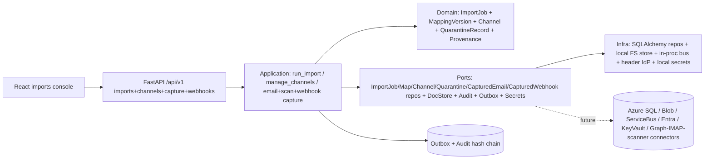
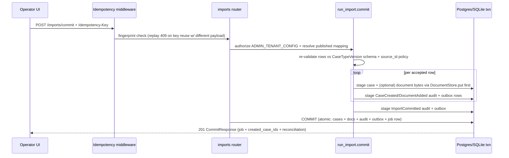

# Architecture — 002-leftovers Run D (Capture & Ingestion Parity)

**Slice**: `specs/002-leftovers/` · **Spec**: [spec.md](./spec.md) (T1) · **Plan**: [plan.md](./plan.md) (Run D)
**Scope**: Run D per `plan.md §1` — FM-026 bulk import (dry-run + atomic commit) + FM-027
channel governance + quarantine triage. Gated FM-028 (mailbox/email), FM-029 (scan),
FM-030 (webhook) ship as fail-closed seams only; they are **not** claimed as ungated.
Track T1 (`spec.md §3 T1`, acceptance `spec.md:55-59`).
**Constitution**: `.specify/memory/constitution.md` — highest authority.
**Status**: Converged — D-1 through D-7 evidenced end-to-end (see §8).
**Last updated**: 2026-09-16

> Inputs read: T1 (`spec.md:34-60`) and FR-L01..FR-L08 (`spec.md:214`),
> `plan.md §1` (Run D) and `§2` (module map), `backend/app/domain/import_job.py`,
> `backend/app/domain/channel.py`, `backend/app/domain/import_mapping.py`,
> `backend/app/domain/provenance.py`, `backend/app/domain/email_capture.py`,
> `backend/app/domain/webhook_capture.py`,
> `backend/app/application/imports/run_import.py` + `source_ids.py`,
> `backend/app/application/channels/manage_channels.py`,
> `backend/app/application/capture/email_capture.py` + `scan_capture.py` +
> `webhook_commands.py`, `backend/app/interfaces/http/routers/imports.py` +
> `channels.py` + `capture.py` + `webhooks.py`,
> `backend/alembic/versions/0030_capture_quarantine_webhook.py`,
> `frontend/src/imports/ImportPreview.tsx` + `Quarantine.tsx`,
> `docs/decisions/ADR-005/006/007`, `docs/integrations/seams.md`.

---

## 1. System overview

Run D makes bulk ingestion trustworthy: an operator previews a versioned import
package (creates/updates/rejects/duplicates, zero writes), commits the approved
package (cases + documents + audit + outbox atomically per record, malformed rows
quarantined per-record), governs tenant channels and validation policies, and
triages the quarantine queue (release/reject, audited). No new runtime topology:
the modular-monolith layering from `001-case-management-platform` is unchanged
(domain pure → application use cases → infrastructure adapters → HTTP interfaces,
audit + outbox committed in the same transaction as the domain change).



## 2. Module map

| Layer | Modules | Responsibility |
|---|---|---|
| Domain | `app/domain/import_job.py` (`ImportJob`, `MappingVersion`, `ImportPackage` alias), `app/domain/import_mapping.py`, `app/domain/channel.py` (`Channel`, `CaptureChannel` alias, `QuarantineRecord`, `evaluate_row`), `app/domain/provenance.py`, `app/domain/email_capture.py`, `app/domain/webhook_capture.py` | Pure aggregates, lifecycle transitions, policy evaluation; no I/O |
| Application | `app/application/imports/run_import.py` (`preview`/`commit`), `app/application/imports/source_ids.py` (batch + known-source dedup), `app/application/channels/manage_channels.py` (enable/disable/capture/inspect/release/reject), `app/application/capture/email_capture.py`, `app/application/capture/scan_capture.py`, `app/application/capture/webhook_commands.py` | Authorization, validation, atomic staging; depends on domain + ports only |
| Infrastructure | `app/infrastructure/persistence/models.py` (`import_jobs`, `import_mappings`, `channels`, `quarantine_records`, `captured_emails`, `captured_webhooks`), `app/infrastructure/persistence/repositories/*` (SQL adapters, `IntegrityError`→`Conflict`), `alembic/versions/0030_capture_quarantine_webhook.py` | SQL adapters, portable DDL, reversible migration |
| Interfaces | `app/interfaces/http/routers/imports.py` (`/imports/dry-run|commit|list|get`), `routers/channels.py` (`/admin/channels`, `/admin/quarantine`), `routers/capture.py` (`/capture/email`, `/capture/scan`), `routers/webhooks.py` (`/webhooks/{channel}` + outbound subscriptions) | Pydantic schemas, OpenAPI tags, `Idempotency-Key`, pagination, `ErrorResponse` |
| Frontend | `frontend/src/imports/ImportPreview.tsx`, `frontend/src/imports/Quarantine.tsx`, generated `src/api/types.gen.ts` via `openapi-typescript` | Dry-run/commit console + quarantine triage; synthetic `example.test` fixtures only |

## 3. Domain model (ER sketch)

```mermaid
erDiagram
  ImportJob ||--|| MappingVersion : pins
  ImportJob ||--o{ ImportRowResult : reconciles
  Channel ||--o{ QuarantineRecord : quarantines
  CapturedEmail }o--|| Channel : "EMAIL kind, enabled"
  CapturedWebhook }o--|| Channel : "WEBHOOK kind, enabled"
  ImportJob }o--o{ Case : "creates 1 per accepted row"
  Case ||--o{ Document : "optional attachment per mapping"
}
```

- `ImportJob` lifecycle `PENDING → PREVIEWED → COMMITTING → COMMITTED|FAILED`; `MappingVersion` immutable once published; re-running an old package pins the mapping snapshot.
- `Channel` kinds `import|api|file_upload|email|scan|webhook`; watched-folder is `IMPORT` with key `folder-<name>` (closed vocabulary).
- `QuarantineRecord` is per-record (`HELD → RELEASED|REJECTED`); payload bytes never persisted on the row (diagnostic `context` keys only, Constitution V).

## 4. Core mutation sequence — `POST /api/v1/imports/commit`



- Dry-run (`POST /imports/dry-run`) runs the same evaluation but stages **zero** case/document/audit/outbox rows; the job row (`PREVIEWED`) is the only write.
- Re-submitting the same `source_record_id` is idempotent: batch repeats + already-owned ids downgrade to `REJECTED/duplicate_source_id` with the pre-existing `case_id` attached (no duplicate case).
- Storage `DependencyUnavailable` quarantines that row only (`document_storage_failed`); the surviving records still commit atomically.

## 5. Guard evaluation trace

| Surface | Gate | Denial |
|---|---|---|
| `POST /imports/dry-run|commit`, `GET /imports`, `POST /admin/channels*`, `POST /admin/quarantine*` | `ADMIN_TENANT_CONFIG` (use case + router, defense-in-depth) | `403` |
| `POST /capture/email` (FM-028, Gated) | `DOCUMENT_UPLOAD` on target case + channel kind `EMAIL` + `enabled` | `403` / `422` |
| `POST /capture/scan` (FM-029, **Gated**) | `ScanAuthorizationProvider.is_enabled()` (`SCAN_CAPTURE_ENABLED`, default `False`) **then** `ADMIN_TENANT_CONFIG` + channel kind `SCAN` + `enabled` | `403 Forbidden` before any write when gated off |
| `POST /webhooks/{channel}` (FM-030, Gated) | HMAC `X-Webhook-Signature` over `{timestamp}.{body}` via `SecretProvider` + 5-min replay window (transport) **then** `CASE_TRANSITION` on the case (application) | `401` transport / `403` application |
| All reads/writes | `WHERE tenant_id = :tenant_id` on every repository method; cross-tenant id → `None`/`404` (never confirms foreign existence) | `404` |

## 6. Seams (Run D status)

| Seam | Port | Local adapter (Run D) | Azure/production adapter | Status |
|---|---|---|---|---|
| Bulk import source | `ImportRowsSource` callable + `ImportJob/Mapping` repos | Synthetic inline rows (CSV/JSON/JSONL) via operator UI | P14 OnBase/Panzura connectors | Local implemented; Azure pending (Gated) |
| Mailbox channel (FM-028) | `CapturedEmailRepository` + `DocumentStore` | JSON-shaped emails over HTTP (`/capture/email`) | Graph/IMAP connector feeds same `capture_email` use case | Local implemented; connector pending (Gated) |
| Scan verdict (FM-029) | `ScanAuthorizationProvider` + `QuarantineRepository` | `scan_result` field on command; `_SettingsScanAuthorization` flag | ClamAV/Defender/OCR connector reports verdict | Local implemented **Gated off by default**; connector pending |
| Webhook secret (FM-030) | `SecretProvider` (`webhook_secret_{channel}`) + `CapturedWebhookRepository` | Local env/file secrets (`./.secrets.json`); HMAC verify in router | Key Vault–backed secrets; P14 producer connector | Local implemented; Azure pending (Gated) |
| Document bytes | `DocumentStore` | `local_document_store.py` (FS) | `AzureBlobDocumentStore` | Local implemented; Azure pending |

## 7. Decisions

- ADR-005 (email, FM-028): `Message-Id`-keyed content idempotency composes with HTTP `Idempotency-Key`; body bytes opaque.
- ADR-006 (scan, FM-029): quarantine-before-document ordering; two-gated authorization; `Gated` default-off amongst FM-028/029/030.
- ADR-007 (webhook, FM-030): `X-Webhook-Id`-keyed ledger + HMAC transport trust + closed command vocabulary; follow-up (ORM row `captured_webhooks` + router mount) **landed in Run D via `0030_capture_quarantine_webhook`** — the ADR's "reserved for follow-up" note is superseded by this Run (see addendum in ADR-007).
- Seams inventory `docs/integrations/seams.md` row 8 updated: enterprise-imports local adapter is now implemented (was "Defer until Phase 3+").

## 8. Convergence verification (Run D, 2026-09-16)

- **FM-026 evidenced**: `POST /api/v1/imports/dry-run` (zero case rows) + `POST /api/v1/imports/commit` (atomic cases + docs + audit + outbox) + `GET /imports` + `GET /imports/{job_id}` in OpenAPI (164 paths); `ImportPreview.tsx` operator console; `preview`/`commit` use cases with `source_ids.py` dedup.
- **FM-027 evidenced**: `POST|GET /api/v1/admin/channels`, `POST /admin/channels/{id}/disable`, `POST /admin/channels/{id}/captures`, `GET /api/v1/admin/quarantine`, `POST /admin/quarantine/{id}/release|reject` in OpenAPI; `Quarantine.tsx` triage console; per-record quarantine with actor/reason audit.
- **Gated not over-claimed**: scan requires `SCAN_CAPTURE_ENABLED=1` (default `False` → `Forbidden`); webhook requires HMAC secret (fail-closed `401`); email requires enabled `EMAIL` channel + `document.upload`. No live Graph/IMAP/scanner/vendor SDK in domain/application.
- **Checks**: `ruff check` PASS; `ruff format --check` PASS (394 files); `mypy --strict app/domain app/application` PASS (207 files); `lint-imports` PASS (3 kept); sqlite phase suites PASS (`test_import*.py` 23 passed; `tests/capture` + `test_capture_invariants` + `test_imports_quarantine_router` 101 passed); `tsc -b --noEmit` PASS; `vite build` PASS (118 modules); migration `0030` round-trip PASS (`downgrade -1` → `0029`, `upgrade head` → `0030`); tenant-isolation targeted suites PASS; synthetic posture PASS (`example.test` fixtures, `SYNTHETIC ENVIRONMENT` marker in `main.py` + UI banner).
- **Exact blockers (outside Run D scope, reported not hidden)**: (1) `alembic check` FAILS repo-wide — drift from other tracks' models not yet migrated (`form_versions`, `retention_policies`, `signed_audit_batches`, `form_bindings`, `disposition_requests` + index renames); Run D tables themselves round-trip cleanly. (2) Full `pytest -q` (1736 tests) exceeds the 120 s tool timeout from a cold start — phase-scoped suites above pass; run the full suite in CI. (3) `uv run ruff` without `uv sync --extra dev` reports "program not found" on a fresh worktree — run `uv sync --extra dev` first (plus `uv pip install aiosqlite` for the sqlite profile on this host). (4) Repo-wide R2 note: several pre-existing files exceed 1000 lines (`models.py`, `execute_transition.py`, `run_import.py` at 1173 incl. docstrings); Run D did not introduce the pattern but `run_import.py` should be split in a follow-up.
