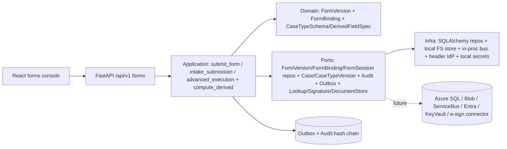
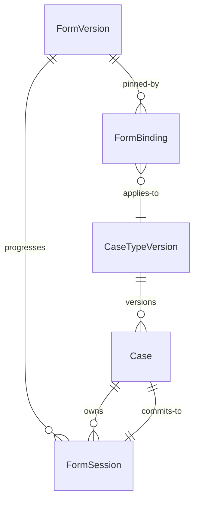

# Architecture — 002-leftovers Run E (Structured Content: Forms + Derived Fields)

**Slice**: `specs/002-leftovers/` · **Spec**: [spec.md](./spec.md) (T3 + T2-meta) · **Plan**: [plan.md](./plan.md) (Run E)
**Scope**: Run E per `plan.md §1` — FM-036 versioned conditional case forms (runtime),
FM-038 advanced form execution (resumable multi-step sessions + state-bound transition
guard), FM-037 visual form designer (authoring surface, same validated format),
FM-012 derived fields + durable field identity (computed at intake/edit, label rename
preserves stable key). Track T3 (`spec.md §3 T3`, acceptance `spec.md:99-101`) plus the
T2-meta derived-field depth item (`spec.md:69`).
**Constitution**: `.specify/memory/constitution.md` — highest authority.
**Status**: Converged — E-1 through E-7 evidenced end-to-end (see §8).
**Last updated**: 2026-09-21

> Inputs read: T3 (`spec.md:84-101`) and FR-L01..FR-L08 (`spec.md:214`),
> `plan.md §1` (Run E) and `§2` (module map), `backend/app/domain/form.py`,
> `backend/app/domain/case_type.py` (DerivedFieldSpec, label_history),
> `backend/app/application/forms/submit_form.py` + `intake_submission.py` +
> `advanced_execution.py`, `backend/app/application/cases/compute_derived.py`,
> `backend/app/interfaces/http/routers/forms.py`,
> `backend/app/infrastructure/persistence/repositories/form_repository.py` +
> `form_mapping.py`, `backend/alembic/versions/0024_form_sessions.py` +
> `0027_import_mapping_and_form_binding_lifecycle.py`,
> `frontend/src/forms/VisualFormDesigner.tsx` + `formValidation.ts` +
> `FormRenderer.tsx` + `MultiStepForm.tsx`,
> `docs/decisions/ADR-033` (FM-038 wiring).

---

## 1. System overview

Run E makes structured content trustworthy: an intake user submits a published
case-bound form (conditional sections, hidden-field preservation, deterministic
validation naming the field, entered data never lost); a worker resumes a multi-step
form across sessions (one open session per case/form/actor triple, CAS on
`version_token`, hidden answers stripped on the wire but preserved server-side);
a transition landing in a state with required state-bound forms is refused until
those forms are submitted; an admin authors the same validated definition format
visually (no second format); derived values compute deterministically at write time
(caller-supplied derived values are dropped, never trusted). No new runtime
topology: the modular-monolith layering from `001-case-management-platform` is
unchanged (domain pure → application use cases → infrastructure adapters → HTTP
interfaces, audit + outbox committed in the same transaction as the domain change).



## 2. Module map

| Layer | Modules | Responsibility |
|---|---|---|
| Domain | `app/domain/form.py` (`FormVersion`, `FormBinding`, `FormFieldSpec`, `FormSectionSpec`, visibility/calculated evaluation), `app/domain/case_type.py` (`DerivedFieldSpec`, `label_history`) | Pure aggregates, lifecycle transitions, publish-time validation; no I/O |
| Application | `app/application/forms/submit_form.py` (`handle`), `app/application/forms/intake_submission.py` (lookup/calculated/signature pipeline), `app/application/forms/advanced_execution.py` (`start/save/submit/resume_session`, `validate_transition_forms`), `app/application/cases/compute_derived.py` | Authorization, visibility evaluation, hidden/read-only preservation, atomic staging; depends on domain + ports only |
| Infrastructure | `app/infrastructure/persistence/models.py` (`form_versions`, `form_bindings`, `form_sessions`), `repositories/form_repository.py` (`SqlFormVersion/Binding/SessionRepository`), `form_mapping.py`, `alembic/versions/0024_form_sessions.py` + `0027_*_form_binding_lifecycle.py` | SQL adapters (CAS on `version_token`), portable DDL, reversible migrations |
| Interfaces | `app/interfaces/http/routers/forms.py` (`POST /forms/cases/{id}`, `GET /forms`, `GET /forms/{key}`, `GET /forms/{key}/bindings`, session start/save/resume, `POST /forms/bindings/{key}/transitions/check`) | Pydantic schemas, OpenAPI tags, `Idempotency-Key` + `If-Match`, pagination, `ErrorResponse` |
| Frontend | `frontend/src/forms/VisualFormDesigner.tsx`, `formValidation.ts`, `FormRenderer.tsx`, `MultiStepForm.tsx`, generated `src/api/types.gen.ts` via `openapi-typescript` | Single-format authoring + runtime rendering + resumable progress; synthetic `example.test` fixtures only |

## 3. Domain model (ER sketch)



- `FormVersion` lifecycle `draft → published → retired`; published snapshots immutable (`assert_mutable`, repo `update_draft` refuses non-draft, SQL test pins refusal).
- `FormBinding` lifecycle draft (`published_at = None`) → published → retired (`retire()` + `mark_retired()`); retired bindings refuse new submissions (`assert_applies_to_case`); cases pin via `case_type_version_id` (G4).
- `FormSession` lifecycle `in_progress → submitted` (terminal; reopening is a new session); only `in_progress` rows resume; CAS on `version_token` (stale → `Conflict`/409).
- `DerivedFieldSpec` operators `add/sub/mul/div/concat/coalesce/if_present` (whitelisted, no arbitrary code); label rename preserves stable `key` with ordered `label_history`.

## 4. Core mutation sequence — `POST /api/v1/forms/cases/{id}` (+ session commit)

```mermaid
sequenceDiagram
  participant UI as Forms UI
  participant MW as Idempotency middleware
  participant API as forms router
  participant UC as submit_form.handle / submit_session
  participant DB as Postgres/SQLite txn
  UI->>MW: POST /forms/cases/{id} + Idempotency-Key + If-Match
  MW->>API: fingerprint check (replay on key reuse w/ different payload)
  API->>UC: authorize CASE_UPDATE + resolve published binding + published version
  UC->>UC: evaluate visible_when (merged stored + referenced submitted keys)
  UC->>UC: drop hidden + read-only/system/calculated inbound; lookup pre-pop; re-evaluate calculated; signature seam; verify attachment refs
  UC->>UC: validate visible required + per-field type/range/pattern/enum + form-level rules (one field-named error, nothing written)
  UC->>UC: compute_derived_fields (caller derived values dropped)
  UC->>DB: stage case UPDATE + CASE_UPDATED audit + outbox rows
  API->>DB: COMMIT (atomic: case + audit + outbox + session flip)
  DB-->>UI: 200 SubmitFormResponse (case_id + reference + version_token + hidden_keys)
```

- Single-step and multi-step commits share the deterministic pipeline (`E-4`); progress saves (`save_step`) never flip to `submitted` on their own — the validated `submit_session` commit is the only writer the transition gate trusts.
- Re-submitting a `submitted` session is idempotent: the stored terminal view returns with no second case write.

## 5. Guard evaluation trace

| Surface | Gate | Denial |
|---|---|---|
| `POST /forms/cases/{id}`, session start/save/submit | `CASE_UPDATE` on the case (use case, before any DB touch) | `403` |
| `GET /forms`, `GET /forms/{key}`, bindings list, transition check | `CASE_READ` on the tenant | `403` |
| Submit/start/submit_session | published binding + published version + binding `case_type_version_id == case.case_type_version_id`; retired binding refused | `422` |
| `save_step` / `submit_session` | `If-Match` CAS on session `version_token` (+ case token on commit); wrong actor; step ahead of current; unknown step | `409` / `403` / `422` |
| Transition guard `validate_transition_forms` | required state-bound forms for `to_state` must be in `submitted_form_keys`; undeclared `state_key` is a hard config error | `allowed=false + missing` / `422` |
| Designer output | backend `_validate_definition` (whitelisted operators, no own-field refs, no visibility cycles, no code-like keys, tab-order uniqueness) | `InvariantViolation` at draft time |
| All reads/writes | `WHERE tenant_id = :tenant_id` on every repository method; cross-tenant id → `None`/`404` (never confirms foreign existence) | `404` |

## 6. Seams (Run E status)

| Seam | Port | Local adapter (Run E) | Azure/production adapter | Status |
|---|---|---|---|---|
| Form persistence | `FormVersion/FormBinding/FormSession` repos | `SqlForm*Repository` (SQLAlchemy, portable types) + migrations `0024`/`0027` | Azure SQL behind same Protocols | Local implemented; Azure pending |
| Lookup pre-population | `lookup` callable (`apply_lookup_prepopulation`) | Deterministic blank-fill; dependency failure → rollback | Configured source adapter | Local implemented; source connector pending (P14) |
| Signature | `signature_connector` (`check_signature_fields`) | `handwritten`/`typed` inline; `external` fails closed without connector | e-sign connector (DocuSign/Adobe as P14) | Local implemented; connector pending (Gated) |
| Attachments | `DocumentStore` + `document_repo` | Pre-uploaded doc-id refs verified in-tenant | `AzureBlobDocumentStore` | Local implemented; Azure pending |
| AI assistance | none in forms path | No ranker/LLM in transitions/auth/disposition (ADR-012 boundary holds) | Bounded-assistance seam only | Not wired by design |

## 7. Decisions

- ADR-033 (FM-038): `form_sessions` table (migration `0024`) + `SqlFormSessionRepository` (CAS) wired into the forms provider (the 501s are gone); `steps` round-trip fixed; start/save endpoints commit; `If-Match` enforced in `save_step`.
- ADR-043 (Run E convergence): binding `retire()` closes the lifecycle (`draft → published → retired` on bindings, not just versions); derived fields compute at write time in `submit_form`/`intake` (never trusted from the caller, never stored procedures); the visual designer emits exactly the runtime-validated `FormDefinition` (no second format — contract pinned both sides); `models_forms.py` stays dead code (live tables in `models.py`); `form_definitions/versions/bindings` tables still lack migrations (tests run on `create_all`) — carried as known debt, not a Run E gap.
- Seams inventory `docs/integrations/seams.md`: no new row (forms reuse seams 1–2 + P14 lookup/signature connectors); no seam flipped.

## 8. Convergence verification (Run E, 2026-09-21)

- **FM-036 evidenced**: `POST /api/v1/forms/cases/{id}` (`Idempotency-Key` + `If-Match` required) + `GET /api/v1/forms` + `GET /api/v1/forms/{key}` + `GET /api/v1/forms/{key}/bindings` in OpenAPI; `FormBinding.retire()` + `mark_retired()` + retired-binding refusal; hidden-required-field router test (conditionally-hidden required does NOT block submit); suites: `tests/forms` + `test_form_definition` + `test_form_submission` + `test_intake_submission` + `tests/interfaces/test_forms_http_contracts.py` + `test_form_session_submit_and_transition_gate.py` — **72 passed** (router + application + gate combined run) and **104 passed** (forms-focused run).
- **FM-038 evidenced**: `SqlFormSessionRepository` (tenant-scoped CRUD, open-lookup ignores `submitted`, CAS stale→`Conflict`) + `POST /forms/cases/{id}/sessions` (idempotent start/resume) + `PATCH .../sessions/{sid}/steps/{step}` (`If-Match`) + `GET .../sessions?form_key=` (resume) + `POST /forms/bindings/{key}/transitions/check` (P07-US7 guard); suites: `tests/forms/test_advanced_execution.py` + `test_form_session_sql.py` + `tests/interfaces/test_form_sessions_router.py` — included in the 72/104 above, all green.
- **FM-037 truthfully classified (authoring surface, not a second runtime)**: `VisualFormDesigner.tsx` emits exactly the backend-validated `FormDefinition`; contract pinned both sides (`tests/domain/test_form_designer_contract.py` 5 tests + `frontend/src/forms/formDefinitionContract.test.ts` + `VisualFormDesigner.test.tsx` — **7 passed** frontend, backend included in 104). No designer-specific persistence, no second format, no code execution in definitions.
- **FM-012 truthfully classified (write-time computation + stable identity, not stored procedures)**: `compute_derived_fields` at intake/edit (`submit_form.handle` + intake paths), caller values dropped, `div/0` → `InvariantViolation`, publish-gate rejects undefined operands; label rename preserves stable `key` with ordered `label_history`; suite `tests/domain/test_derived_fields.py` — included in 104, all green.
- **Checks**: `mypy --strict app/domain app/application` PASS (208 files); `lint-imports` PASS (3 kept, 401 files); `tsc -b --noEmit` PASS (exit 0); vitest forms contract PASS (7 tests); migration portability tokens PASS (`test_baseline_migrations_column_types_are_generic`, `use_no_forbidden_tokens`); `test_migration_model_parity.py -k "form"` PASS (2 passed); tenant-isolation suites PASS (form version/session repos + cross-tenant `NotFound`); immutability suites PASS (`tests/audit/test_immutability.py` + `test_audit_chain.py`, 32 passed); synthetic posture PASS (`example.test` seed fixtures, no PHI in forms/derived suites, `SYNTHETIC ENVIRONMENT` wiring in `main.py`).
- **Exact blockers (outside Run E scope, reported not hidden)**: (1) `ruff check .` FAILS repo-wide — **16 errors**: 13 in `app/domain/form.py` (Run E scope: `I001` import sort; `PLR0912/PLR0915` complexity on `__post_init__`/`_validate_definition`/`_check_condition`/`validate_field_value`/`evaluate_calculated`; `PLR0911` returns; 4× `SIM118` `key in dict.keys()`), plus `dump_openapi_live.py` 2× `T201 print` and `tests/application/test_import_idempotency.py` `C409` (both outside Run E). (2) `ruff format --check .` FAILS — **4 files** would be reformatted, including `app/domain/form.py` (Run E) and `alembic/versions/0029_*` plus the two known-drift files (`app/db.py`, `tests/application/configuration/test_load_case_type.py` per `remaining_h1_plan.md:36`). (3) Full migration upgrade/downgrade replay (`test_baseline_migrations_upgrade_downgrade_replay`) exceeds the 180 s tool timeout on this host — targeted migration suites above pass; run the full replay in CI. (4) Stale-code-comment note (not a gate): `app/interfaces/http/routers/forms.py:358-365` header + `_form_session_repo_or_501` docstring still say "FM-038 deferred / SQL adapter reserved for follow-up" — ADR-033 and the wired `SqlFormsHttpDependencyProvider.session` prove the 501s are gone; the comments should be reworded in a follow-up (left untouched here per minimal-scope rule). (5) `pnpm typecheck` via the PowerShell wrapper surfaces a `NativeCommandError` artifact — direct `npx tsc -b --noEmit` exits 0; not a type failure.
