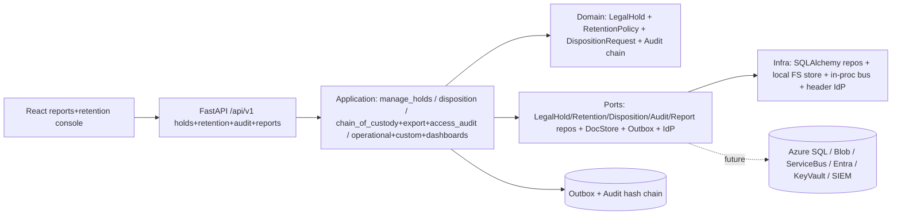
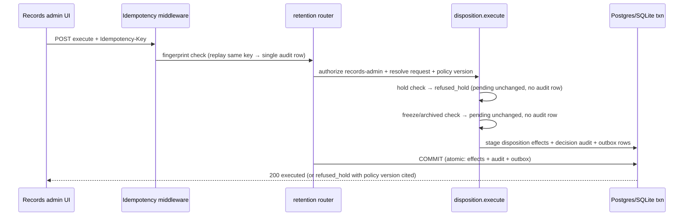

# Architecture — 002-leftovers Run F (Records, Audit Evidence & Reporting)

**Slice**: `specs/002-leftovers/` · **Spec**: [spec.md](./spec.md) (T6) · **Plan**: [plan.md](./plan.md) (Run F)
**Scope**: Run F per `plan.md §1` — FM-039 legal-hold lifecycle + FM-040 versioned
retention/reviewed disposition + FM-041 archival/disposition automation + FM-042
defensible-deletion evidence + FM-044 audit export/corrective annotations + FM-045
access-decision audit + FM-051 operational reports + FM-053 governed export/custom
definitions + FM-054 fresh dashboards. Gated FM-046 (SIEM streaming / externally
verifiable evidence) ships as fail-closed mechanics only; it is **not** claimed as
ungated. Track T6 (`spec.md §3 T6`, acceptance `spec.md:166-169`).
**Constitution**: `.specify/memory/constitution.md` — highest authority.
**Status**: Converged — F-2 through F-7 evidenced end-to-end (see §8). No separate
F-1 commit exists on this branch; the Run F kickoff/planning input is recorded in
`remaining_h1_plan.md` Slice 5 (FM-039) plus the T6 track definition itself, and the
landed sequence F-2 (legal-hold lifecycle) → F-3 (retention/disposition rules) →
F-4 (persistence + migration 0031) → F-6 (operational reporting services) →
F-5 (evidence + governed export) → F-7 (records/reporting API + UI) covers the
full T6 scope.
**Last updated**: 2026-09-21

> Inputs read: T6 (`spec.md:149-169`) and FR-L01..FR-L08 (`spec.md:214`),
> `plan.md §1` (Run F) and `§2` (module map), `backend/app/domain/legal_hold.py`,
> `backend/app/domain/retention.py`, `backend/app/domain/audit.py`
> (`DISPOSITION_REFUSED`), `backend/app/application/retention/disposition.py`,
> `backend/app/application/holds/manage_holds.py`,
> `backend/app/application/audit/chain_of_custody.py` +
> `export_audit` + `access_audit` + `siem_stream.py` (Gated),
> `backend/app/application/reports/operational_reports.py` + `custom_reports.py` +
> `dashboards.py`, `backend/app/interfaces/http/routers/holds.py` +
> `retention.py` + `audit.py` + `reports.py`,
> `backend/alembic/versions/0026_create_legal_holds_table.py` +
> `0031_retention_disposition.py`,
> `frontend/src/reports/OperationalReports.tsx` + `frontend/src/retention/Archival.tsx`,
> `docs/decisions/ADR-009` (SIEM gate), `docs/integrations/seams.md`.

---

## 1. System overview

Run F makes records governance defensible: a security admin places an audited hold
that blocks disposition of the case, its documents, and its audit evidence
(`refused_hold`, no partial delete); retention policies publish as immutable
versions; eligible cases route through an approve/reject disposition review with
reason-bearing decisions; archival tiers, freeze windows, and orphan proposals
operate without silent deletion; every export and every disposition writes its own
audit row while original events stay immutable; operational reports and dashboards
render current-state KPIs with source-time and authorization scope. No new runtime
topology: the modular-monolith layering from `001-case-management-platform` is
unchanged (domain pure → application use cases → infrastructure adapters → HTTP
interfaces, audit + outbox committed in the same transaction as the domain change).



## 2. Module map

| Layer | Modules | Responsibility |
|---|---|---|
| Domain | `app/domain/legal_hold.py` (`LegalHold`, `REFUSED_HOLD_CODE="refused_hold"`), `app/domain/retention.py` (`RetentionPolicy`, `DispositionRequest`), `app/domain/audit.py` (`DISPOSITION_REFUSED`) | Pure aggregates, lifecycle transitions, clock/pause math; no I/O |
| Application | `app/application/holds/manage_holds.py` (place/release), `app/application/retention/disposition.py` (publish/route/approve/reject/execute, clock pause-on-hold), `app/application/audit/chain_of_custody.py` (evidence report), `export_audit`, `access_audit`, `siem_stream` (**Gated**), `app/application/reports/operational_reports.py` + `custom_reports.py` + `dashboards.py` | Authorization, validation, atomic staging; depends on domain + ports only |
| Infrastructure | `app/infrastructure/persistence/models.py` (`legal_holds`, `retention_policies`, `disposition_requests`), SQL repositories, `alembic/versions/0026_*` + `0031_retention_disposition.py` | SQL adapters, portable DDL, reversible migration |
| Interfaces | `routers/holds.py` (`POST|DELETE /cases/{id}/holds`), `routers/retention.py` (policy/disposition/archival/freeze/orphan), `routers/audit.py` (`/audit/export`, `/audit/access-decisions`, signed batches **Gated**), `routers/reports.py` (`/reports/open-cases|overdue-tasks|custom-definitions|custom/{id}|custom/{id}/export`, dashboards) | Pydantic schemas, OpenAPI tags, `Idempotency-Key`, pagination, `ErrorResponse` |
| Frontend | `frontend/src/reports/OperationalReports.tsx`, `frontend/src/retention/Archival.tsx`, generated `src/api/client.ts` via `openapi-typescript` | Reports console + archival triage; synthetic `example.test` fixtures only |

## 3. Domain model (ER sketch)

```mermaid
erDiagram
  Case ||--o| LegalHold : "active hold blocks disposition"
  RetentionPolicy ||--o{ DispositionRequest : routes
  DispositionRequest }o--|| Case : reviews
  Case ||--o{ AuditEvent : "evidence (append-only, hash-chained)"
  DispositionRequest ||--o| AuditEvent : "decision row (approve/reject + reason)"
  AuditEvent ||--o{ SignedBatch : "Gated external verifiability"
}
```

- `LegalHold` lifecycle `PLACED → RELEASED`; disposition clock **pauses** on hold and
  resumes on release (spec §9 open question #5 resolved: pause-and-resume, never reset).
- `RetentionPolicy` versions immutable once published (`draft → published → retired`;
  publish of v2 supersedes without mutating v1; published rows frozen against mutation).
- `DispositionRequest` review `PENDING → APPROVED|REJECTED → EXECUTED`; approve/reject
  require admin role + reason (reject); double-approve, approve-after-reject, and
  decided-row updates are `Conflict` with a single audit row (no duplicate writes);
  held/frozen/archived cases refuse with `pending` unchanged and no audit row.
- Archival/freeze/orphan rows remain in-memory seam placeholders by design (migration
  `0031` scope note); report definitions (FM-053) remain in-memory; evidence bundles
  are computed archives whose export is itself an `AuditExported` row.

## 4. Core mutation sequence — `POST /api/v1/retention/dispositions/{id}/execute`



- Held-case disposition returns `outcome="refused_hold"` with the policy version
  cited; nothing is partially deleted.
- Idempotent replay of `execute`/`approve` yields a single audit row (`Conflict` on
  re-entry, no second write).

## 5. Guard evaluation trace

| Surface | Gate | Denial |
|---|---|---|
| `POST|DELETE /cases/{id}/holds` | records/security admin (use case + router, defense-in-depth) | `403` |
| Retention publish/approve/reject/execute | admin role; reject requires reason; frozen-window/archived/held cases refuse | `403` / `422` / `refused_hold` |
| `GET /audit/export`, report `.../export` | `audit.export` (export action is itself audited via `AuditExported`) | `403` |
| `GET /audit/access-decisions` | security role (P09-US6 / FM-045; P11-US9) | `403` |
| Signed batches / SIEM surface (FM-046, **Gated**) | `audit.stream` — ungranted by default, deny-by-default per ADR-009 | `403 Forbidden` before any stream write |
| All reads/writes | `WHERE tenant_id = :tenant_id` on every repository method; cross-tenant id → `None`/`404` (never confirms foreign existence) | `404` |
| Report/dashboard reads | team-scope authorization at result time; sensitive values redacted by reference-id | `403`, redacted snippets |

## 6. Seams (Run F status)

| Seam | Port | Local adapter (Run F) | Azure/production adapter | Status |
|---|---|---|---|---|
| Records persistence | `LegalHold/Retention/Disposition` repos | SQLAlchemy repos (portable generics) + migrations `0026`/`0031` | Azure SQL behind same Protocols | Local implemented; Azure pending |
| Evidence export | `AuditEventStore` + `SignedBatchRepository` | Structured export + chain-of-custody report over local store; `InMemorySignedBatchRepository` | SIEM streaming / signed-batch verification service | Export local implemented; **stream Gated off (ADR-009)** |
| Report rendering | `ReportDefinition` repository | In-memory definitions + SQL read models | Same port; engine unchanged | Local implemented; Azure pending (no engine change) |
| AI assistance | none in records path | No ranker/LLM in holds/disposition/export decisions (Constitution XIV holds) | Bounded-assistance seam only | Not wired by design |

## 7. Decisions

- ADR-044 (Run F convergence): hold-before-disposition ordering with `refused_hold`
  refusal rows; retention-clock pause-on-hold/resume-on-release; published-policy
  immutability with version-supersede; disposition review as single-step
  approve/reject (no ticket object — same rationale as FM-017); in-memory
  archival/freeze/orphan/report-definition placeholders declared as design (not
  gaps); FM-046 stays Gated (`audit.stream` ungranted).
- Seams inventory `docs/integrations/seams.md`: no new row (records reuse seams
  1–3); no seam flipped.

## 8. Convergence verification (Run F, 2026-09-21)

- **FM-039 evidenced**: `POST` + `DELETE /api/v1/cases/{id}/holds` (F-2:
  `LegalHold` aggregate + `place_hold`/`release_hold` + SQL repo + hold scanner);
  held close/dispose refused with `refused_hold`; release allows close; timeline
  surfaces hold state; suite `tests/retention/test_held_disposition_refusal.py`.
- **FM-040 evidenced**: versioned policies (`draft → published → retired`,
  v2-supersede, frozen published rows) + disposition routing/approve/reject/execute
  with reason-bearing decisions + clock pause-on-hold/resume (F-3 domain + gates);
  durable `retention_policies` + `disposition_requests` tables via migration `0031`
  (F-4); suite `tests/retention/test_retention_clock_and_gates.py` (999 lines:
  publish/approve/reject/execute/conflict/replay/forbidden/held/frozen/archived).
- **FM-041 evidenced**: archive/unfreeze/freeze/orphan routes + tests
  (`tests/retention/test_archival.py`); no silent deletion (orphan proposals, freeze
  windows cancelable with effect restore).
- **FM-042 evidenced**: chain-of-custody / defensible-deletion evidence report
  (F-5: `chain_of_custody.py` + `tests/audit/test_chain_of_custody.py` 513 lines +
  `tests/retention/test_evidence_report.py`); cites disposed-what under which
  policy version by whom/when.
- **FM-044 evidenced**: `GET /api/v1/audit/export` (structured export with chain
  hashes; export appends its own `AuditExported` row) + corrective annotations as
  append-only compensating events; suite `tests/audit/test_export_correction.py`.
- **FM-045 evidenced**: `GET /api/v1/audit/access-decisions` (allow + deny with
  action/resource/actor/reason); suite `tests/audit/test_access_audit.py`.
- **FM-051 evidenced**: `GET /api/v1/reports/open-cases` + `/overdue-tasks`
  team-scoped to authorization (F-6); suite `tests/reports/test_operational_reports.py`.
- **FM-053 evidenced**: `POST /reports/custom-definitions` +
  `GET /reports/custom/{id}` + audited CSV `POST .../export` (`audit.export`
  required, `AuditExported` staged in the same transaction); suite
  `tests/reports/test_custom_reports.py` + `tests/reports/test_reporting_depth.py`.
- **FM-054 evidenced**: dashboard endpoints with source-time + authorization scope
  per KPI (F-7: `tests/interfaces/test_records_reports_contracts.py` 608 lines);
  frontend `OperationalReports.tsx` + `Archival.tsx` consoles.
- **Gated FM-046 not over-claimed**: signed-batch mechanics operable
  (`InMemorySignedBatchRepository`, `signed_batch_store: local-in-memory` in
  health) but `audit.stream` is ungranted by default (deny-by-default per ADR-009);
  no SIEM target selected, no stream write possible without an explicit grant.
- **T6 acceptance**: held disposition → `refused_hold` with policy version cited,
  no partial delete ✓; every export/disposition writes its own audit event,
  originals never mutated ✓; dashboards carry source-time + scope ✓.
- **Checks**: `ruff check` on all Run F files PASS; `ruff format --check` on all
  Run F files PASS (22 files); `mypy --strict app/domain app/application` PASS
  (209 files); `lint-imports` PASS (3 kept, 402 files / 2570 deps); sqlite suites
  PASS (`tests/retention` + `tests/reports` + `tests/audit` **214 passed**;
  `tests/interfaces/test_records_reports_contracts.py` **15 passed**;
  `test_immutability` + `test_records_persistence_parity` **17 passed** incl.
  two-tenant isolation + per-tenant append-only chain replay + migration/model
  parity columns); migration `0031` upgrade/downgrade SQL renders portable DDL
  both directions (generic types only); synthetic posture PASS (`example.test`
  fixtures; the single `ssn` literal in tests is a redaction test asserting
  `"***"` output, not fixture PHI; `SYNTHETIC ENVIRONMENT` wiring in `main.py`).
- **Exact blockers (outside Run F scope, reported not hidden)**: (1) `ruff check
  app` FAILS repo-wide — **13 errors, all in `app/domain/form.py`** (Run E scope,
  already carried as known debt in ADR-043: `I001`, `PLR0912/PLR0915`,
  `PLR0911`, `SIM118`); Run F introduces zero new findings. (2) `ruff format
  --check app` flags **exactly 1 file: `app/domain/form.py`** (same Run E debt);
  all Run F files formatted. (3) Full `tests/foundation/test_baseline_migrations.py`
  exceeds the 300 s tool timeout on this host (same highest-risk gate already
  flagged in `T0-5-commit-plan.md` T0-1); targeted migration evidence above
  passes — run the full replay in CI. (4) Full `pytest -q` exceeds the tool
  timeout from a cold start — phase-scoped suites above pass; run the full suite
  in CI.
