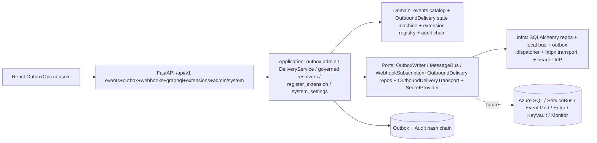

# Architecture — 002-leftovers Run G (Operability: Outbox, Events, Webhooks, Governed Queries)

**Slice**: `specs/002-leftovers/` · **Spec**: [spec.md](./spec.md) (T7) · **Plan**: [plan.md](./plan.md) (Run G)
**Scope**: Run G per `plan.md §1` — FM-052 failed-work/outbox operations +
FM-055 versioned event catalog and reliable delivery, then FM-056
authenticated outbound webhooks + FM-057 governed ad-hoc query surface.
FM-047 versioned extension/event-type registration rides the same catalog
surface (union catalog). T7 admin/config governance (FM-021) and T7
diagnostics/system utilities land as the operability console (G-5/G-6/G-7).
Track T7 (`spec.md §3 T7`, acceptance `spec.md:188-191`).
**Constitution**: `.specify/memory/constitution.md` — highest authority.
**Status**: Converged — G-2 through G-7 evidenced end-to-end (see §8). No
separate G-1 commit exists on this branch; the Run G kickoff/planning input
is the T7 track definition (`spec.md:171-191`) plus `plan.md §1` (Run G)
and the `remaining_tasks.md` FM-052/055 pull-order rows, and the landed
sequence G-2 (event catalog + outbox hardening) → G-4 (governed queries) →
G-5 (diagnostics/storage admin) → G-3 (webhook delivery hardening) → G-6
(HTTP/OpenAPI surface) → G-7 (operability admin UI) covers the full T7
operability scope.
**Last updated**: 2026-09-22

> Inputs read: T7 (`spec.md:171-191`) and FR-L01..FR-L08 (`spec.md:214`),
> `plan.md §1` (Run G) and `§2` (module map), `backend/app/domain/events.py`
> (catalog + `validate_payload` + `validate_publication`),
> `backend/app/domain/extension.py` (process-local registry + union catalog),
> `backend/app/domain/outbound_webhook.py` (`WebhookSubscription` +
> `OutboundDelivery` + `backoff_delay_seconds`/`delivery_due`),
> `backend/app/application/webhooks/outbound.py` (`DeliveryService` +
> `dispatch_pending` + `attempt`),
> `backend/app/infrastructure/messaging/outbox_dispatcher.py` (safe-error
> redaction + `MAX_ATTEMPTS=5` + exponential backoff),
> `backend/app/infrastructure/webhooks/httpx_transport.py` +
> `delivery_dispatcher.py`,
> `backend/app/interfaces/graphql/schema.py` + `resolvers.py` (governed
> bounds + policy-enforced resolvers + `GraphQLQueryExecuted` audit),
> `backend/app/interfaces/http/routers/events.py` + `admin_outbox.py` +
> `webhooks.py` + `extensions.py` + `graphql.py` + `admin_system.py`,
> `backend/app/application/configuration/system_settings.py` +
> `backend/app/infrastructure/system/local_system_adapters.py`,
> `frontend/src/admin/OutboxOps.tsx`,
> `docs/decisions/ADR-013` (outbound webhooks) + `ADR-045` (system/diagnostics),
> `docs/integrations/seams.md`.

---

## 1. System overview

Run G makes async operation trustworthy: every domain change commits its
audit row and its outbox row in one transaction; the outbox dispatcher
drains with safe-error redaction, bounded retry (5s/10s/20s/40s, cap 300s,
`MAX_ATTEMPTS=5`), and dead-letter surfacing instead of silent loss; the
event catalog (`EVENT_CATALOG`, 16 versioned types) is the single contract
subscribers negotiate against with additive-only publication checks;
outbound webhook deliveries fan out per `(subscription, event)` with
HMAC-SHA256 signing (optional JWT bearer), idempotent enqueue on
`UNIQUE (tenant_id, subscription_id, event_id)`, backoff-gated dispatch,
and poison fast-path to dead-letter; governed queries (`POST
/api/v1/graphql`) resolve through the application service layer only, with
tenant-implicit scoping, field redaction, document policy filtering, query
bounds (8000 chars / 30 selections / depth 4 / limit ≤200), and a
`GraphQLQueryExecuted` audit row per request; extension modules register as
versioned units whose event types join the union catalog (built-ins win on
conflict); diagnostics/storage admin stays infrastructure-only and
fail-closed. No new runtime topology: the modular-monolith layering from
`001-case-management-platform` is unchanged (domain pure → application use
cases → infrastructure adapters → HTTP interfaces, audit + outbox committed
in the same transaction as the domain change).



## 2. Module map

| Layer | Modules | Responsibility |
|---|---|---|
| Domain | `app/domain/events.py` (`EVENT_CATALOG` 16 specs, `validate_payload`, `is_backward_compatible`, `validate_publication`, `DomainEvent`), `app/domain/extension.py` (process-local `ExtensionRegistry`, union catalog, persistent overlay deferred to FM-047 slice 2), `app/domain/outbound_webhook.py` (`WebhookSubscription`, `OutboundDelivery.record_attempt/record_permanent_failure`, `backoff_delay_seconds`/`delivery_due`) | Pure aggregates, catalog contract, retry state machine; no I/O |
| Application | `app/application/webhooks/outbound.py` (`DeliveryService.dispatch_pending/attempt`, transport-fault tolerance, backoff gate), `app/application/extensions/register_extension.py` (governed registration, `ExtensionRegistered` audit), `app/application/configuration/system_settings.py` (versioned settings, optimistic concurrency, redacted audit) | Authorization, validation, atomic staging; depends on domain + ports only |
| Infrastructure | `app/infrastructure/messaging/outbox_dispatcher.py` (`sanitize_error`, `MAX_ATTEMPTS=5`, backoff schedule), `app/infrastructure/webhooks/httpx_transport.py` + `delivery_dispatcher.py`, `app/infrastructure/system/local_system_adapters.py` (`LocalStorageVolume`, `LocalEncryptionAtRest`, `LocalDiagnosticsService`) | Adapter implementations, portable SQL, retry loops |
| Interfaces | `routers/events.py` (`GET /events/catalog`), `routers/admin_outbox.py` (outbox inspect/replay), `routers/webhooks.py` (subscription CRUD + disable/retire/replay), `routers/extensions.py` (`POST|GET /extensions`, union `GET /extensions/events/catalog`), `routers/graphql.py` + `interfaces/graphql/schema.py` + `resolvers.py` (`POST /api/v1/graphql`), `routers/admin_system.py` (settings/diagnostics/cache/storage) | Pydantic schemas, OpenAPI tags, `Idempotency-Key`, pagination, `ErrorResponse` |
| Frontend | `frontend/src/admin/OutboxOps.tsx` (+ `.test.tsx`), generated `src/api/types.gen.ts` via `openapi-typescript` | Outbox/dead-letter triage console; synthetic `example.test` fixtures only |

## 3. Domain model (ER sketch)

```mermaid
erDiagram
  Outbox ||--o{ DomainEvent : drains
  DomainEvent }o--|| EventTypeSpec : "catalog-validated (additive-only versions)"
  WebhookSubscription ||--o{ OutboundDelivery : "one row per subscription+event"
  OutboundDelivery }o--|| DomainEvent : "replay-stable event_id"
  ExtensionModule ||--o{ EventTypeSpec : "union catalog (built-ins win)"
  Case ||--o{ AuditEvent : "GraphQLQueryExecuted per request"
}
```

- `EventTypeSpec` versions are additive-only: a higher version must carry
  every key of every lower version (`validate_publication`); removal/rename
  is a new `event_type`, not a new version (P13 Q2, ADR-023).
- `OutboundDelivery` lifecycle `PENDING → SUCCEEDED`, `PENDING → PENDING`
  (retry while attempts < cap), `PENDING → DEAD_LETTERED` (cap reached or
  poison); operator replay resets `DEAD_LETTERED → PENDING`. The transition
  is owned by `record_attempt`/`record_permanent_failure` in the domain, not
  by callers — no caller can retry forever by forgetting the cap check.
- `WebhookSubscription` lifecycle `ACTIVE → DISABLED → RETIRED`; empty
  `event_filters` is rejected (fail-closed: match nothing by default);
  `version_token` guards concurrent reconfiguration (`If-Match`).
- Extension event types join the union catalog deduplicated by
  `(event_type, version)`; built-in entries win on conflict (compatibility:
  old subscribers never lose the built-in contract to an overlay).

## 4. Core mutation sequence — outbox write → dispatch → webhook fan-out

```mermaid
sequenceDiagram
  participant UC as Domain use-case
  participant DB as Postgres/SQLite txn
  participant Disp as Outbox dispatcher tick
  participant Bus as MessageBus + catalog subscriber
  participant WH as DeliveryService.dispatch_pending
  UI->>UC: mutation + Idempotency-Key
  UC->>UC: validate_payload(event_type, payload) — PHI/key whitelist
  UC->>DB: stage domain change + audit hash row + outbox row
  UC->>DB: COMMIT (atomic: effects + audit + outbox)
  Disp->>DB: claim due rows (skip not-due so poison cannot starve batch)
  Disp->>Bus: publish envelope (event_id stable, correlation_id from payload)
  Bus->>DB: enqueue OutboundDelivery per matching ACTIVE subscription (UNIQUE tenant+sub+event → replay returns prior row)
  WH->>WH: skip not-due rows (no POST, no counter touch); manual attempt bypasses gate
  WH->>DB: record_attempt (success / retry / dead-letter) or record_permanent_failure (poison/missing-secret/missing-sub)
```

- Replay of an already-delivered event is idempotent at two layers: the
  `UNIQUE (tenant_id, subscription_id, event_id)` constraint returns the
  prior delivery row, and the wire carries a stable `X-Webhook-Event-Id`
  so the subscriber dedupes replays.
- A raising transport is recorded as a retriable `status_code=None`
  failure instead of killing the tenant drain.

## 5. Guard evaluation trace

| Surface | Gate | Denial |
|---|---|---|
| `GET /events/catalog` | any authenticated actor (anonymous cannot enumerate the surface) | `401` |
| `POST /extensions`, union catalog | `ADMIN_TENANT_CONFIG`; duplicate key + different shape → `409` (identical retry → `200 installed:False`) | `403` / `409` |
| Webhook subscription CRUD/disable/retire/replay | operator role (`WEBHOOK_SUBSCRIPTION_MANAGE`); `PATCH` requires `If-Match` | `403` / `409` on stale token |
| Webhook dispatch | `matches_event` (ACTIVE + filter hit) + tenant scope; HTTPS enforced outside `local` (`http://localhost` allowed for the synthetic demo) | skipped (no row), never delivered cross-tenant |
| `POST /api/v1/graphql` | authenticated; resolvers call `authorize` + `redact_case_data` + `DOCUMENT_READ` classification filter; bounds 8000/30/4/200; mutations/variables rejected at parse | `401` / `403` with null branch (never partial data) / `400` / `422` |
| Outbox/admin-system surfaces | operator/admin roles; settings updates need `expected_version`; secrets render `[REDACTED]` | `403` / `409` |
| All reads/writes | `WHERE tenant_id = :tenant_id` on every repository method; cross-tenant id → `None`/`404` or null+error (never confirms foreign existence) | `404` / null branch |
| Error surfacing | `sanitize_error` (outbox) + 500-char truncation (deliveries); `key=[REDACTED]` for sensitive pairs | safe error only, no secret/PHI leak |

## 6. Seams (Run G status)

| Seam | Port | Local adapter (Run G) | Azure/production adapter | Status |
|---|---|---|---|---|
| Messaging / events | `MessageBus` + outbox dispatcher + `EVENT_CATALOG` | `local_message_bus.py` + `outbox_dispatcher.py` (in-proc loop, same code path as the hosted worker) | Azure ServiceBus publisher + hosted worker (Functions/Container Apps) | Local implemented; Azure pending (placeholder + README) |
| Outbound webhook transport | `OutboundDeliveryTransport` | `httpx_transport.py` (thin `httpx.AsyncClient` wrapper; app layer never imports `httpx`) | `azure_event_grid_transport/` placeholder (README contract) | Local implemented; Azure pending |
| Webhook signing secrets | `SecretProvider` | `LocalSecretProvider` (env/file); missing secret → immediate dead-letter `missing_secret:<name>` | Azure KeyVault | Local implemented; Azure pending |
| Extension registry | process-local `ExtensionRegistry` | In-memory install + `ExtensionRegistered` audit; persistent `extension_registry` table deferred to FM-047 slice 2 (declared design, same Protocols) | Same port; durability when a pilot needs queryable history | Local implemented; persistence deferred by design |
| Diagnostics/storage admin | `LocalStorageVolume` / `LocalEncryptionAtRest` / `LocalDiagnosticsService` | Serves `local-fs`; declares `azure-blob`/encryption posture explicitly (`declared` vs `actual`, fail-closed) | `AzureBlobDocumentStore` / KeyVault field encryption / Monitor-OTLP | Local implemented; Azure pending (ADR-045) |
| AI assistance | none in operability path | No ranker/LLM in outbox/dispatch/webhook/graphql decisions (Constitution XIV holds) | Bounded-assistance seam only | Not wired by design |

No `seams.md` row added or flipped: Run G reuses seams 2/3/5/6 and the
webhook transport placeholder reserved by ADR-013; the extension-registry
table stays a declared slice-2 seam (not a gap).

## 7. Decisions

- ADR-046 (Run G convergence): additive-only event versioning with
  publication-time breaking-change rejection; domain-owned webhook
  dead-letter cap with backoff-gated dispatch and poison fast-path;
  transport-fault tolerance (raising adapter → retriable failure, drain
  survives); governed-query null-branch denials with bounds parity between
  HTTP and direct `execute()`; extension union catalog with built-ins-wins
  compatibility; process-local registry with persistent overlay deferred;
  diagnostics/storage as infrastructure-only fail-closed adapters; no new
  seam rows.
- Prior ADRs incorporated unchanged: ADR-013 (outbound webhooks + G-3
  hardening addendum), ADR-023 (event compatibility), ADR-045 (system
  configuration/diagnostics/storage), ADR-010 (extension boundary).

## 8. Convergence verification (Run G, 2026-09-22)

- **FM-052 evidenced**: admin outbox inspect/replay (`routers/admin_outbox.py`;
  G-2 `outbox_dispatcher.py` hardening: `sanitize_error` redaction,
  `MAX_ATTEMPTS=5`, 5s/10s/20s/40s backoff with `next_attempt_at` skip);
  `OutboxOps.tsx` triage console (G-7); suites `tests/messaging/test_outbox.py`
  (12) + `tests/messaging/test_outbox_hardening.py` (safe errors, tenant
  scope, idempotent replay) + `tests/interfaces/test_ops_events_webhooks_contracts.py`
  (26 incl. outbox re-export + diagnostics/storage assertions).
- **FM-055 evidenced**: 16-type `EVENT_CATALOG` (`domain/events.py:369`;
  queue/task lifecycle types registered so the dispatcher never
  dead-letters them as unknown); `validate_payload` (PHI-name + whitelist,
  catalog-checked at `DomainEvent` construction so bad rows never reach the
  durable outbox); `validate_publication`/`is_backward_compatible`
  (additive-only, duplicate-shape and version-regression rejection);
  `GET /api/v1/events/catalog` (authenticated, `Page` contract);
  suites `tests/events/test_event_versioning.py` + `tests/events/test_event_catalog.py`
  (publication compatibility matrix, unknown-type dead-letter instead of publish).
- **FM-056 evidenced**: `WebhookSubscription` + `OutboundDelivery` aggregates
  with domain-owned `record_attempt(max_attempts)` / `record_permanent_failure`
  (G-3: no caller can retry forever); `backoff_delay_seconds`/`delivery_due`
  on the G-2 schedule (naive SQLite reads normalized to UTC);
  `dispatch_pending` skips not-due rows without POSTing or touching the
  counter (manual `attempt` bypasses by design); raising transports recorded
  as retriable `status_code=None`; HMAC-SHA256 canonical `timestamp.body` +
  optional JWT bearer; `UNIQUE (tenant_id, subscription_id, event_id)` +
  `X-Webhook-Event-Id` idempotency layers; suites `tests/webhooks/test_outbound.py`
  + `test_delivery_dispatcher.py` + `tests/webhooks/test_outbound_resilience.py`
  (timeout/retry/poison/retirement, duplicate-POST event-id stability,
  fail-closed subscription auth, no secret material in logs/rows/audit/wire).
- **FM-057 evidenced**: `POST /api/v1/graphql` with resolvers calling the
  application service layer only (no repository/store/model imports —
  pinned by `test_governed_graphql__never_bypasses_service_layer` and the
  no-infrastructure-import test); tenant-implicit scoping (no `tenantId`
  argument; cross-tenant case → null+error, cross-tenant list → empty);
  field redaction (`redact_case_data` + `can_see_sensitive`) and
  `DOCUMENT_READ` classification filtering; bounds
  (8000/30/4/limit≤200, mutations/variables rejected at parse, oversize
  rejected); per-request `GraphQLQueryExecuted` audit without result data;
  suites `tests/graphql/test_governed_graphql.py` +
  `tests/graphql/test_governed_query_bounds.py` (33) +
  `tests/interfaces/test_graphql_router.py` + GraphQL contract smoke in the
  ops-contracts suite.
- **FM-047 evidenced**: `POST|GET /extensions` (governed registration,
  `ADMIN_TENANT_CONFIG`, idempotent identical retry vs `409` on shape
  conflict, non-admin denied) + `GET /extensions/events/catalog` union
  (built-in + extension types, built-ins win, pagination truncates);
  suite `tests/extensions` (10) + extension contract block in the
  ops-contracts suite (register happy-path, idempotency-key required,
  conflict matrix, catalog union). Persistent `extension_registry` table
  remains declared slice-2 design (same Protocols), not a gap.
- **T7 acceptance**: concurrent config edit → structured `conflict`, no
  silent overwrite ✓ (`expected_version`/`If-Match` on settings +
  subscriptions); replay of already-delivered event is idempotent ✓ (unique
  constraint + stable wire event id); poison message dead-letters with safe
  error only ✓ (sanitized + truncated, `record_permanent_failure` for
  poison/missing-secret/missing-subscription); ad-hoc query attempting
  unauthorized field/doc returns `forbidden` with null branch, never partial
  data ✓.
- **Checks**: `ruff check` on all 14 Run G source files PASS; `ruff format
  --check` on all 14 PASS; `mypy --strict app/domain app/application` PASS
  (210 files); `lint-imports` PASS (3 kept, 408 files / 2607 deps);
  sqlite suites PASS (events+messaging+webhooks **90 passed**;
  graphql-bounds+router+ops-contracts+extensions **62 passed**;
  governed-graphql full **33 passed**; extensions **10 passed**;
  system-settings+admin-system-router **31 passed** incl. two-tenant
  isolation, cross-tenant null/empty denials, and per-tenant dead-letter
  scoping); synthetic posture PASS (`example.test` subscriber URLs; seed
  creates no subscriptions per ADR-013 §11; `SYNTHETIC ENVIRONMENT` wiring
  in `main.py:537`); compatibility PASS (additive-only publication gate +
  union-catalog built-ins-win + stable wire event ids).
- **Exact blockers (outside Run G scope, reported not hidden)**: (1) repo-wide
  `ruff check app` reports **13 errors, all in `app/domain/form.py`** (Run E
  scope, already carried as known debt in ADR-043); Run G introduces zero
  new findings. (2) Full `pytest -q` from a cold start exceeds the tool
  timeout on this host (same posture as Run F convergence); phase-scoped
  suites above pass — run the full suite in CI. (3) `docker compose`
  Postgres path not exercised here per AGENTS.md host limitation (WSL
  registry flakiness); sqlite profile is the supported local verification,
  Postgres parity rides the portable-generics + migration-parity gates in CI.
