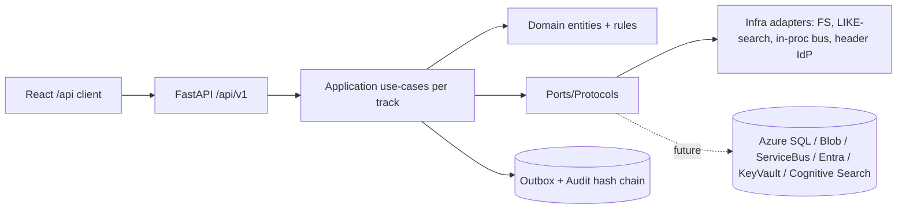

# Architecture: 002-leftovers (umbrella)

This slice converges one Run at a time. Per-run architecture docs:

- [Run A — Security first (FM-048, FM-011, FM-021)](./architecture-runA.md) —
  role administration, sensitive-field redaction boundary, governance history.
  Contains the required Mermaid flowchart and the role-assignment
  audit-plus-outbox sequence.
- [Run B — Worker value (FM-031, FM-032, FM-033, FM-034, FM-016, FM-017, FM-018)](./architecture-runB.md) —
  structured/saved/in-case/semantic search, queue operations, second-actor
  approvals with SoD preflight, SLA authoring validation and breach visibility.
  Contains the required Mermaid flowchart and the search authorization-trace
  sequence.
- [Run C — Content depth (FM-025, FM-023 ext, T5-US1/US2/US3)](./architecture-runC.md) —
  document protection (restrict/redact/file-lock), rendition burns via the
  existing `DocumentStore` port, annotation/checkout/re-index viewer pipeline,
  x-refs/separation-plans/packages/hash-dedup/CSV, permissioned bundles +
  share-by-link, worker home under admin policy. Contains the required
  Mermaid flowchart and the redaction-version lifecycle sequence.
- [Run D — Capture & ingestion parity (FM-026, FM-027; FM-028/029/030 gated)](./architecture-runD.md) —
  versioned import packages with dry-run preview + atomic commit, channel
  governance, per-record quarantine triage, fail-closed email/scan/webhook
  seams. Contains the required Mermaid flowchart and the
  `POST /imports/commit` idempotency → audit → outbox sequence.
- [Run E — Structured content (FM-036, FM-038; FM-037/FM-012 classified)](./architecture-runE.md) —
  versioned conditional case forms with binding retire, resumable multi-step
  sessions (CAS) + state-bound transition guard, single-format visual designer,
  write-time derived fields + stable field identity. Contains the required
  Mermaid flowchart and the `POST /forms/cases/{id}` idempotency → audit →
  outbox sequence.
- [Run F — Records, audit evidence & reporting (FM-039/040/041/042/044/045/051/053/054; FM-046 Gated)](./architecture-runF.md) —
  legal-hold lifecycle with `refused_hold` disposition refusal, versioned
  retention with pause-on-hold clock + approve/reject disposition review,
  archival/freeze/orphan controls, chain-of-custody evidence, audit export with
  append-only corrections, access-decision reporting, team-scoped operational
  reports + governed export/custom definitions + source-timed dashboards.
  SIEM streaming stays Gated (`audit.stream` ungranted per ADR-009). Contains
  the required Mermaid flowchart and the disposition-execute idempotency →
  audit → outbox sequence.

