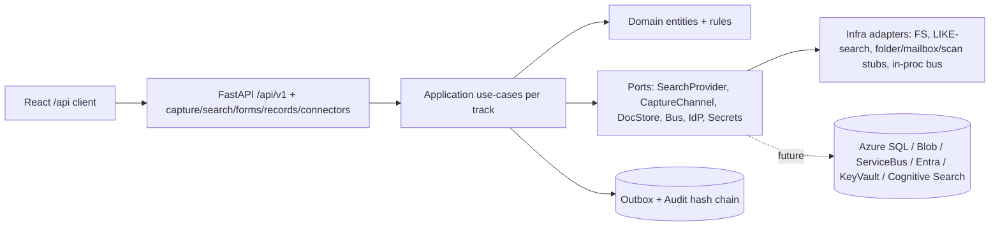

# Implementation Plan: 002-leftovers

**Spec**: [spec.md](./spec.md) · **Branch**: `002-leftovers` · **Created**: 2026-09-11
**Roadmap**: [../pillars/00-product-roadmap.md](../pillars/00-product-roadmap.md) · **Feature map**: [../pillars/01-deduplicated-feature-map.md](../pillars/01-deduplicated-feature-map.md)

## 1. How to build this (no big-bang)

This is an umbrella spec. Per `AGENTS.md §19`, each track becomes 1+ Orca DAG Runs of 4–12 tasks, each touching ≤3 files + tests. Recommended split:

- Run A (security first): FM-048 role-admin + FM-011 sensitive controls + FM-021 governance (unblocks search/queues).
- Run B (worker value): FM-031 structured search + FM-016 queues + FM-017 approvals + FM-018 SLA.
- Run C (content depth): FM-025 protection/redaction/lock + viewer pipeline + T5 UX.
- Run D (capture): FM-026 import + FM-027 quarantine/governance.
- Run E (structured content): FM-036 forms runtime, then FM-038 advanced execution; FM-037 designer last.
- Run F (governance depth): FM-039 hold + FM-040 retention/disposition + FM-051 reports.
- Run G (operability): FM-052 outbox ops + FM-055 event catalog, then FM-056 webhooks + FM-057 governed queries.
- Run H (Gated): FM-058/059/060 connectors/coexistence/bundles — only with explicit authorization.

Do not pull >2 H1 features concurrently (`01-deduplicated-feature-map.md:158` pull order wins on conflict).

## 2. Architecture delta (extends 001 plan, does not fork it)

Reuse `001-case-management-platform/first-slice/plan.md:50` module map. New modules live behind existing ports:

```
backend/app/
  domain/
    capture.py          # CaptureChannel, Provenance, QuarantineRecord
    search.py           # SearchQuery, SearchResult, SavedSearch
    forms.py            # FormDefinition/Version, FormSubmission
    records.py          # Hold, RetentionPolicy, DispositionCase
    connectors.py       # Connector, ConnectorAuthorization, CoexistencePolicy
    annotations.py      # Annotation, Redaction, CheckoutLock, DocBundle
  application/
    capture/            # submit_package.py, dry_run.py, triage_quarantine.py
    search/             # structured_search.py, saved_search.py
    forms/              # submit_form.py, render_form.py
    records/            # place_hold.py, evaluate_retention.py, dispose.py
    reporting/          # operational_reports.py, export_report.py
    connectors/         # authorize_connector.py, run_import.py, export_bundle.py
    events/             # register_event_type.py, deliver_webhook.py
  infrastructure/
    capture/            # local_folder_channel.py, bulk_package_parser.py, mailbox_stub.py, scan_stub.py
    search/             # like_search_provider.py (portable; FTS later as adapter)
    storage/            # rendition_store.py (extends DocumentStore, same port)
    ai/                 # no-op advisor stub (Constitution XIV seam only)
  interfaces/http/routers/
    capture.py, search.py, forms.py, records.py, reports.py, connectors.py, webhooks.py
```

Layer rules unchanged: `domain` pure; `application` depends on `domain` via Protocol ports; `infrastructure` implements ports; `interfaces` depends on `application` only. Verify with `import-linter` per Run.



## 3. Data & migrations

- Extend `infrastructure/persistence/models.py` with generic types only (`Uuid, JSON, DateTime(timezone=True), Text, String, Integer, Boolean`). Every new table carries `tenant_id` + UTC timestamps + indexes on `(tenant_id, ...)` FKs.
- New tables: `import_packages, mapping_versions, quarantine_records, saved_searches, search_audit_events, form_definitions, form_versions, form_submissions, holds, retention_policies, disposition_cases, evidence_bundles, connectors, connector_authorizations, report_definitions, event_type_versions, webhook_subscriptions, annotations, redactions, checkout_locks, doc_bundles`.
- Alembic: one revision per Run, both `upgrade`/`downgrade`, portable SQL, no `JSONB/GIN/ILIKE/tsvector/gen_random_uuid()`.
- Retention/hold enforcement at application + DB check constraint; audit append-only trigger extended to new event types.

## 4. API & frontend contracts

- Prefix `/api/v1/...`; `Page[T]` default 50 max 200; `ErrorResponse{code,message,details,correlation_id}`; `Idempotency-Key` on mutations; `If-Match` on versioned writes; `X-Correlation-Id` throughout.
- New routes (each with OpenAPI tags + Pydantic schemas): `POST /imports/dry-run`, `POST /imports/commit`, `GET /quarantine`, `POST /quarantine/{id}/release|reject`, `GET /search/cases`, `GET|POST /search/saved`, `POST /forms/{id}/submit`, `GET /queues`, `POST /queues/{id}/claim|release|delegate`, `POST /transitions` (approval-gated), `POST /holds`, `POST /retention/evaluate`, `GET /reports/open-cases`, `GET /reports/overdue-tasks`, `GET /ops/outbox`, `POST /ops/outbox/replay`, `GET /events/catalog`, `POST /webhooks/subscriptions`, `POST /connectors/authorize|retire`, `POST /bundles/export`.
- Frontend: regenerate `src/api/types.gen.ts` via `openapi-typescript` per Run; TanStack Query keys `["search",...]`, `["imports",...]`, `["forms",...]`; no hand-typed API shapes.

## 5. Testing & gates (per Run)

- `uv run ruff check . && uv run ruff format --check . && uv run mypy --strict app/domain app/application && uv run lint-imports verify` then `APP_ENV=test DATABASE_URL='sqlite+aiosqlite:///./.pytest.db' uv run pytest -q` + `pnpm typecheck`.
- Coverage >=80% on `domain`+`application`; two-tenant isolation test per new repo; redaction test per new read; idempotent-replay + stale-token + dependency-failure tests per new mutation.
- Synthetic-data check: `grep -R example.test` passes; no PHI patterns in fixtures.

## 6. Risks

| Risk | Mitigation |
|---|---|
| Umbrella spec tempts big-bang | Enforce one Run per track; gate on Done per track (`tasks.md` AC per Run). |
| Full-text/OCR/barcode drift into vendor SDK in domain | Adapters only in `infrastructure/`; domain sees `SearchProvider`/`CaptureChannel` Protocols + fakes in tests. |
| Saved-search/search-audit becomes access bypass | Authorization at result time + snippet redaction; dedicated security tests. |
| Connector scope creep (real-time sync) | One-way batched migration only; coexistence fields are provenance, not authority; Gated Runs need approval record. |
| File bloat (>600 lines) | Split by responsibility per R2; refactor check per task-done. |

## 7. Open decisions deferred to slice Runs

- Search engine adapter (LIKE now; FTS/Cognitive later) — T2 Run decides via ADR.
- Offline conflict semantics + retention-clock pause/resume — T8/T6 Runs decide via ADR.
- SOAP compat: only if a pilot proves need; otherwise REST-only (record in ADR).
